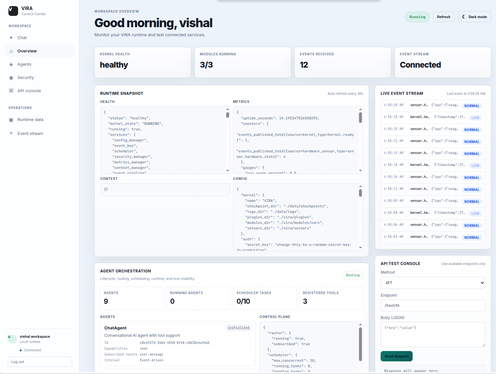
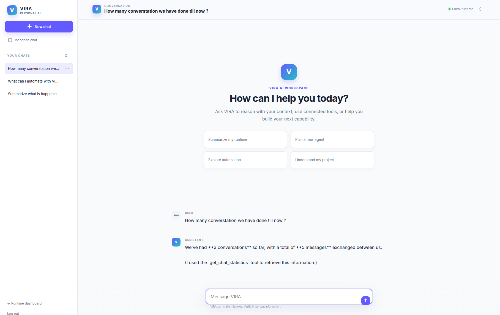

<div align="center">

# VIRA

### Your personal AI system — and the framework to build it

[](#license)
[](#development-status)
[](#development-status)
[](#core-principles)
[](#contributing)

*Private by design. Local-first. Extensible by default.*

</div>

> ### 🧪 Want to see the current build? Try the AppImage
>
> The quickest way to test VIRA is the prebuilt **AppImage** (Linux x86_64) — no
> clone, no virtualenv.
>
> 1. Download the latest `VIRA-<version>-build<N>-x86_64.AppImage` (and its `.sha256`)
>    from the **[Releases page](https://github.com/Vishalsng112/VIRA/releases)**.
>    Each build is also attached to the *Build AppImage* GitHub Actions run.
> 2. Run it:
>
>    ```bash
>    sha256sum -c VIRA-*-x86_64.AppImage.sha256   # optional integrity check
>    chmod +x VIRA-*-x86_64.AppImage
>    ./VIRA-*-x86_64.AppImage
>    ```
> 3. Open <http://localhost:8000>, create the admin account, then use `/chat`.
>
> Your data and `config.yaml` live in `~/.local/share/vira` (not inside the
> AppImage), so they survive upgrades. You still need
> [Ollama](https://ollama.com/download) running with the default model
> (`ollama pull ornith:9b`) for chat. AppImage builds are *pre-releases* of the
> current development state; if a build predates a feature described below, build
> from source ([Quick Start](#quick-start)) instead.

---

---

## Table of Contents

- [What is VIRA?](#what-is-vira)
- [Why VIRA?](#why-vira)
- [What VIRA can do today](#what-vira-can-do-today)
- [Quick Start](#quick-start)
- [Multi-user and multi-device](#multi-user-and-multi-device)
- [Core Principles](#core-principles)
- [How it works](#how-it-works)
- [Architecture](#architecture)
- [Project Structure](#project-structure)
- [Development Status](#development-status)
- [Roadmap](#roadmap)
- [Contributing](#contributing)
- [License](#license)

---

## What is VIRA?

VIRA is an open-source **personal AI system and extensible agent framework**. It is designed to become the intelligence layer around your digital life: aware of your workspace and system, able to remember context, able to use tools, and able to coordinate specialized agents.

VIRA is not a single-purpose end product. It is a programmable foundation for building personal AI capabilities:

- **Personal AI runtime** — a local kernel that observes system and workspace state.
- **Context engine** — durable conversations, scoped memory, and bounded context for reasoning.
- **Agent platform** — agents implement `think → plan → act → reflect` and react to events.
- **Tool platform** — local and MCP tools with permissions, auditing, and artifacts.
- **Operations layer** — health, metrics, event streams, agent visibility, and runtime controls.
- **Future creation engine** — describe a need in natural language and VIRA can eventually generate an agent, tool, workflow, or small application, then verify it before use.

The current implementation is local-first and privacy-oriented. It uses local persistence and supports local LLM providers such as Ollama; external providers are optional and explicitly configured.

### A framework, not just an assistant

An assistant answers requests. A personal AI system can understand its environment,
retain useful context, coordinate capabilities, and safely gain new skills.
VIRA is being built as the runtime for that system:

| Layer | Role |
|---|---|
| Kernel | Lifecycle, state, events, scheduling, security, and operations |
| Sensors | Structured observations from the machine, workspace, and activity |
| Context and memory | Durable conversations, scoped memory, and relevant prompt context |
| Agents | Specialized reasoning and action loops |
| Tools | Permissioned local, MCP, and future generated capabilities |
| Creation engine | Future natural-language generation and verification of agents and code |

That means VIRA can be used as a personal assistant today, an agent-development
framework tomorrow, and eventually a local capability factory for the tasks you
choose to automate.

### DASHBOARD
---
<!-- add image -->


### Agent sandboxes

On Linux, agents can use the Bubblewrap-backed `sandbox` tool. Each sandbox is
created below `/AgentWorkspace` by default and exposes only its own writable
`/workspace` and `/artifacts` directories. Network access is disabled by
default, and common host data directories are hidden from the sandbox. Install
Bubblewrap before starting VIRA:

```bash
sudo apt-get install bubblewrap
sudo mkdir -p /AgentWorkspace
sudo chown "$USER":"$USER" /AgentWorkspace
```

The sandbox tool supports `create`, `execute`, `archive`, `restore`, and
`delete`, plus controlled `install` for Python packages. Installation creates
`/workspace/.venv` and temporarily enables network access only for the pip
installation command; regular sandbox commands remain network-isolated.
Package specifications are validated and are not allowed to contain shell
syntax. VIRA uses namespace and mount restrictions rather than a blacklist of
commands, so commands such as `rm` cannot reach files outside the task
workspace. Bubblewrap shares the host kernel and is intended for Linux
development workloads; use a container or microVM for hostile code.

For convenience, `execute` automatically creates a sandbox when `sandbox_id`
is omitted. Its result includes the generated `sandbox_id` and absolute
workspace path, so a relative output such as `figure.png` is located under
`/AgentWorkspace/<sandbox-id>/workspace/figure.png`.

`execute` can also receive `packages` in the same request. It installs those
packages before execution and runs `python` through the workspace virtual
environment. Both a command string and an argument list are accepted.

### Autonomous behavior agent

VIRA includes an optional `AutonomousBehaviorAgent` configured in
[`config.yaml`](./config.yaml). It observes hardware and activity sensor
events, maintains rolling baselines, stores learned summaries as
`behavior_pattern` memories, and emits an `autonomous.decision` message after a
configured number of sustained anomalies. Decisions are rate-limited by a
cooldown and currently notify/store evidence only; the agent does not execute
host commands or make irreversible changes.

Tune `window_size`, `anomaly_sigma`, `anomaly_minimum`,
`consecutive_anomalies`, `decision_cooldown_seconds`, and `learning_interval`
under the agent configuration. Disable it with `enabled: false` when it is not
needed.

### CHAT AGENT
---
<!-- add image -->

---
# Quick Start

VIRA can be run either **natively** (recommended for development) or using **Docker** (recommended for isolated environments).

---

## 🚀 The Fastest Way to Run VIRA

> **Goal:** install Python, install Ollama with VIRA's default local model,
> start VIRA, and open the dashboard.
>
> **Time:** about 5–10 minutes, depending on the model download speed.

### ✅ Step 1 — Install Python

Install **Python 3.11 or newer** from [python.org/downloads](https://www.python.org/downloads/).
During Windows installation, enable **Add Python to PATH**.

Check that Python is ready:

```bash
python --version
```

> On some Linux systems, use `python3` instead of `python`.

### ✅ Step 2 — Download VIRA

```bash
git clone https://github.com/Vishalsng112/VIRA.git
cd VIRA
```

### ✅ Step 3 — Install Python dependencies

```bash
python -m pip install --upgrade pip
python -m pip install -r requirements.txt
```

### ✅ Step 4 — Install Ollama and VIRA's default model

VIRA uses **Ollama** for local AI inference and is configured by default to use
the **`ornith:9b`** model.

| Platform | Install Ollama |
|---|---|
| Linux | `curl -fsSL https://ollama.com/install.sh \| sh` |
| macOS / Windows | Download the installer from [ollama.com/download](https://ollama.com/download) |

After installing Ollama, download the model:

```bash
ollama pull ornith:9b
```

If Ollama is not already running, start it in a separate terminal:

```bash
ollama serve
```

> **Hardware note:** `ornith:9b` is a local 9B-parameter model. The first
> download is large and response speed depends on your available RAM/VRAM.

### ✅ Step 5 — Start VIRA

From the VIRA project directory:

```bash
python run.py
```

You should see the local server start. Open the dashboard in your browser:

<div align="center">

### 🎉 [Open the VIRA Dashboard →](http://localhost:8000)

`http://localhost:8000`

</div>

On the first visit, create your local admin account. After signing in, open
`http://localhost:8000/chat` to use the personal AI workspace.

<details>
<summary>🛠️ Quick troubleshooting</summary>

- **`python` not found:** try `python3`, or reinstall Python with PATH enabled.
- **`ollama` not found:** restart your terminal after installing Ollama.
- **Model not found:** run `ollama pull ornith:9b` again.
- **VIRA cannot connect to Ollama:** make sure `ollama serve` is running.
- **Port 8000 is busy:** stop the process using the port, then run VIRA again.

</details>

---

## Prerequisites

Before getting started, ensure the following software is installed:

- Python **3.11+**
- Git
- Pip
- UV or Conda
- Docker *(only for Docker installation)*
- Ollama with the `ornith:9b` model *(required for local LLM inference)*

---

# Option 1: Native Installation (Recommended)

### 1. Clone the Repository

```bash
git clone https://github.com/Vishalsng112/VIRA.git
cd VIRA
```

### 2. Create a Python Environment

Choose **one** of the following options.

**Using Conda**

```bash
conda create -n vira python=3.11 -y
conda activate vira
```

**Using UV**

```bash
uv venv --python 3.11

# Linux/macOS
source .venv/bin/activate

# Windows
.venv\Scripts\activate
```

### 3. Install Dependencies

```bash
python -m pip install --upgrade pip
pip install -r requirements.txt
```

### 4. Start Ollama

Ensure the Ollama service is running before launching VIRA.

### 5. Launch VIRA

```bash
python run.py
```

Once the server starts, open:

```
http://localhost:8000
```

---

# Option 2: Docker Installation

### 1. Clone the Repository

```bash
git clone https://github.com/Vishalsng112/VIRA.git
cd VIRA
```

### 2. Build the Docker Image

```bash
bash docker_build.sh
```

### 3. Start the Container

```bash
bash docker_run.sh
```

### 4. Launch VIRA

Inside the running container:

```bash
python run.py
```

The dashboard will be available at:

```
http://localhost:8000
```

`0.0.0.0` is the server bind address, not the address to use in a browser. Use
`http://localhost:8000` (or `http://127.0.0.1:8000`) on the host running VIRA.

---

## Verify the Installation

After launching VIRA, open your browser and navigate to:

```
http://localhost:8000
```

If the dashboard loads successfully, the installation has completed successfully.

The dashboard currently provides:
- Live runtime snapshot (`/health`, `/metrics`, `/context`, `/config`)
- Module visibility and module loading controls
- Live event stream monitoring
- Agent orchestration, tool, and security visibility
- Authenticated API access for conversations, runs, memories, and operations
- Built-in API test console for authenticated framework endpoints

The dashboard is the operator surface for the local runtime; the API and framework packages are the extension surface for developers.

Open `/chat` for the personal AI workspace. It provides a conversation-first
interface with persistent chats, message history, new-chat creation, and chat
deletion backed by the local database.

The chat agent also has permissioned access to local aggregate tools, such as
reporting the authenticated user's total chat and message counts, without
exposing raw database access to the model.

The MCP shell tool can answer approved runtime and system-information questions
such as the current date/time, working directory, platform, and repository
status without enabling arbitrary shell execution.

Chats can also be started in **Incognito chat** mode. Incognito conversations
are stored in dedicated local tables so they can be restored and deleted like
normal chats, but they are excluded from normal chat statistics and cannot be
used as memory sources.

The MCP tool surface includes a permissioned web-browsing tool so agents can
retrieve current public information when a question requires research.

---
## Multi-user and multi-device

One VIRA **server** can now serve several users and several **endpoint devices**.
The server owns identity, authorization, persistence and orchestration; devices
(laptops, phones, other machines) are clients that register, authenticate with
their own revocable credential and send events. **The server itself is also an
endpoint device**: it registers itself at startup, and its built-in sensors go
through exactly the same validated ingestion path as remote devices.

| Concept | Summary |
|---|---|
| Users | Created by an administrator (`admin` / `user` roles); can be disabled or soft-deleted; the last active admin is protected. |
| Devices | Registered by a signed-in user; lifecycle `pending → active → revoked → retired`. |
| Device credentials | Separate from user sessions, shown **once**, stored hashed, scoped, expiring, rotatable and revocable without touching the user's password or other devices. |
| Access grants | Many-to-many user ↔ device with `owner`, `operator` or `viewer` roles. Users only see devices they were granted. |
| Events | Server-resolved `device_id`, source component, client and server timestamps, idempotent by `event_id`, allow-listed types, per-class retention. |
| Streams | `/events/stream` is filtered per user and per device grant; viewers receive metadata without payloads. |

### First steps

```bash
# 1. Open http://localhost:8000 and create the first admin (bootstrap works only once).

# 2. Sign in and create another user (admin only)
curl -s -c jar -H 'Content-Type: application/json' \
     -d '{"username":"admin","password":"..."}' http://localhost:8000/api/v1/auth/login
curl -s -b jar -H 'Content-Type: application/json' \
     -d '{"username":"alice","role":"user"}' http://localhost:8000/api/v1/admin/users
# -> returns a one-time temporary password and recovery code

# 3. On another machine, enrol it as a device and start reporting
python -m vira.clients.endpoint_agent enroll --server http://SERVER:8000 \
       --username alice --name "Alice laptop"
python -m vira.clients.endpoint_agent run
```

The reference client stores its credential in a `0600` file, queues events in a
local SQLite file while offline and retries with backoff. If the device is
revoked on the server, the client stops.

### API at a glance (`/api/v1`)

| Area | Endpoints |
|---|---|
| Auth | `POST /auth/bootstrap`, `/auth/login`, `/auth/logout`, `GET /auth/me`, `POST /auth/password/change`, `/auth/sessions/revoke-all` |
| Admin | `GET/POST /admin/users`, `GET/PATCH/DELETE /admin/users/{id}`, `GET /admin/devices`, `GET /admin/audit`, `GET /ops/devices/health` |
| Devices (user) | `POST/GET /devices`, `GET/PATCH /devices/{id}`, `POST /devices/{id}/credentials:rotate`, `/revoke`, `/retire`, `POST /devices/{id}/access`, `DELETE /devices/{id}/access/{user_id}`, `GET /devices/{id}/events`, `GET /devices/{id}/state` |
| Devices (credential) | `POST /devices/{id}/heartbeat`, `POST /devices/{id}/events:batch` |
| Chat | `POST /conversations/{id}/messages` (optional `device_id`), `GET /conversations`, `GET /runs/{id}`, `/memories` |
| Streaming | `GET /events/stream` (Server-Sent Events, access-filtered) |

Errors use `{"detail": ..., "error": {"code", "message", "correlation_id"}}`; every
response carries `X-Correlation-ID`. The older unversioned routes (`/chat`,
`/conversations`, …) remain as legacy adapters used by the bundled web UI; new
clients should use `/api/v1`. Kernel, config, metrics, module and agent-control
routes are **administrator-only**.

### Configuration

The `devices:` section of [`config.yaml`](./config.yaml) controls credential
lifetime, whether the server device is shared with all users (`share_with_all_users`),
batch/payload limits, rate limits and the event-type allow-list with per-class
retention. Telemetry payloads (e.g. clipboard content) are not kept at rest by default.
Existing `config.yaml` files without this section keep working with the defaults.

### Security notes

- Set a random `auth.secret_key` and put VIRA behind **TLS** before exposing it to remote devices.
- A device can never claim a user identity: `device_id` comes from its credential, and `user.*`, `agent.*`, `command.*`, `kernel.*` and `system.*` event types are always rejected.
- Upgrading an existing database is automatic and idempotent (versioned migrations); existing users keep working and receive a public id.

> Design: [`VIRA_MULTI_DEVICE_DESIGN.md`](./docs/VIRA_MULTI_DEVICE_DESIGN.md) ·
> What was implemented and what is still open:
> [`docs/MULTI_DEVICE_IMPLEMENTATION.md`](./docs/MULTI_DEVICE_IMPLEMENTATION.md)

---
## Why VIRA?

Most AI assistants begin with a blank prompt. They do not continuously understand your environment, retain structured personal context, or provide a safe runtime for extending their capabilities.

VIRA takes a different approach:

```text
Your intent
    ↓
Persistent conversation + memory
    ↓
Context-aware agent reasoning
    ↓
Permissioned tools and operations
    ↓
Auditable result
```

The long-term vision is a personal AI system that can understand what you need, assemble the right capabilities, and improve its usefulness without becoming an opaque process running outside your control.

## What VIRA can do today

### Understand and remember

- Persist conversations and ordered messages across restarts.
- Create, rename, archive, and delete conversations.
- Use idempotent message submission with correlation and run tracking.
- Store scoped memories by user, agent, conversation, and memory type.
- Search, expire, delete, and compact memory.
- Assemble bounded context before sending information to an LLM.

### Sense and react

- Collect system, hardware, process, network, workspace, project, and activity signals.
- Route typed events through a central dispatcher and event bus.
- Distinguish commands from domain events.
- Run event-driven agents with explicit lifecycle states.

### Extend safely

- Build agents with the `think → plan → act → reflect` contract.
- Register capabilities, schemas, versions, and subscribed events.
- Enable, disable, register, and unregister agents.
- Connect local and MCP tools.
- Enforce tool permissions before execution.
- Audit every tool call with request, result, status, permission decision, and duration.
- Store large results as artifacts outside transactional message rows.

### Operate transparently

- Inspect kernel health, sensors, context, metrics, agents, tools, event lag, and outbox status.
- Persist durable state changes through an SQLite outbox.
- Retry failed durable event publication.
- Use an authenticated dashboard and API (administrators) and the chat workspace (all users).
- Serve multiple users and devices from one server, with per-device provenance and access-filtered event streams.

---

## Core Principles

| Principle | What it means |
|---|---|
| Local-first privacy | No hidden telemetry or cloud dependency. External providers are opt-in and configured by you. |
| Open source | MIT licensed — free to study, fork, and build on. |
| Context as infrastructure | Context isn't bolted onto an AI model as an afterthought — it's the core data structure the kernel is built around. |
| User-aware, not just machine-aware | VIRA models how *you* use your system — your workflow, rhythms, and intent — not just what's running on the hardware. |
| Trust through verification | Future generated agents and tools should be checked before they run. |

---

## How it works

VIRA is built around focused **sensors**, each watching one part of your system. Observations flow through a shared **event bus** into a context engine that builds a unified, constantly-updating model of your machine, workspace, conversations, memories, and behaviour.

| Sensor | What it watches |
|---|---|
| System | CPU, memory, load, OS state |
| Hardware | Hardware metrics and resource usage |
| Process | Running processes and their lifecycle |
| Network | Network activity and connectivity |
| Application | Which apps are active and what they're doing |
| Workspace | File system and workspace changes |
| Project | Project structure and metadata |
| Activity | User behaviour patterns and workflow rhythms |
| Context | Aggregates everything into bounded, AI-ready context |

Agents consume events and context, plan work, use permissioned tools, and publish results. Durable conversations, runs, memories, and outbox events are stored locally, while high-volume telemetry remains in bounded runtime metrics.

The architecture is intentionally modular: individual sensors, agents, tools, storage adapters, LLM providers, and transports can be extended without rewriting the personal AI runtime.

---

## Architecture

For a full technical breakdown of the framework — subsystems, event schemas, agent spec, sensor spec, memory schema, workflow schema, and config reference — see the framework documentation:

> 📖 **[VIRA Framework Documentation →](./docs/VIRA_DOCS.md)**
>
> 🏗️ **[System Design: HLD, LLD, persistence, and database selection →](./docs/SYSTEM_DESIGN.md)**

The documentation covers:
- Full architecture diagram (all layers: Kernel, Event Bus, Agent Orchestration, LLM, Memory, Tools)
- Canonical event format and naming convention
- How to write an agent (`BaseAgent` interface + full example)
- How to write a sensor (`BaseSensor` interface + full example)
- Memory types and schemas
- Workflow DAG schema and example
- Complete `config.yaml` reference
- LLM provider configuration (Ollama, OpenAI, Anthropic)
---

## Project Structure

```
├── config.yaml
├── docs/
│   ├── MULTI_DEVICE_IMPLEMENTATION.md ← Multi-user / multi-device implementation notes
│   ├── VIRA_DOCS.md          ← Framework documentation & schemas
│   └── VIRA_architecture.svg ← Architecture diagram
├── CONTRIBUTING.md           ← Contribution guide
├── requirements.txt
├── run.py
└── vira/
    ├── kernel/               ← EventBus, Dispatcher, Kernel, StateManager …
    ├── sensors/              ← System, hardware, filesystem, user-activity sensors
    ├── agent/                ← BaseAgent, AgentMailbox, examples/
    ├── agent_orchestration/  ← AgentManager, Registry, Router, WorkflowEngine
    ├── agent_runtime/        ← AgentRuntime (bridges agent ↔ LLM/memory/tools)
    ├── llm/                  ← LLMManager + Ollama/OpenAI/Anthropic adapters
    ├── memory/               ← MemoryManager + MemoryEntry schema
    ├── tools/                ← ToolExecutor, ToolRegistry, MCP server
    ├── modules/core/         ← Built-in kernel modules
    ├── plugins/              ← Drop-in plugin directory
    ├── api/                  ← FastAPI app, device/admin routes, access-filtered SSE
    ├── auth/                 ← Sessions, typed principals, user admin, migrations
    ├── devices/              ← Device registry, credentials, access grants, event ingestion
    └── clients/              ← Reference endpoint client (enrol, queue, send)
```

---

## Development Status

**Current phase: building the personal AI foundation.**

The core runtime is functional end-to-end. VIRA now has the major primitives required for a personal AI system:

- Kernel lifecycle, typed events, dispatcher, outbox, and retry path — functional
- System, hardware, process, network, workspace, project, and activity sensors — functional
- Durable conversations, messages, runs, correlation IDs, and idempotency — functional
- Scoped memory, expiry, search, deletion, and bounded context assembly — functional
- Agent lifecycle, capabilities, event subscriptions, versioned definitions, and allow-listing — functional
- Local and MCP tool registry with permission checks and durable tool-call auditing — functional
- Authenticated dashboard and operations APIs — functional (administrators only)
- Multi-user accounts, device registration, device credentials, access grants, and device event ingestion — implemented; the server registers itself as a device
- Not yet: PostgreSQL/broker adapters, web UI for user and device administration, Android/iOS clients, TLS/CSRF hardening (see the implementation notes)
- High-frequency sensor collection — primarily polling today; OS-native event adapters remain a goal
- Linux is the primary supported development platform today

The framework is intentionally ahead of the end-user feature set: it provides the runtime surface on which many personal AI applications can be built.

**On the implementation language:** the project is currently written entirely in Python. Core parts will later be rewritten in Rust — system-level components in Rust, exposed to the rest of the framework as Python modules. This keeps the contribution surface accessible while allowing the kernel and runtime to be progressively optimized without disrupting the broader codebase.

---

## Roadmap

### Iteration 1 — Personal AI Runtime *(implemented foundation)*

Build a complete, stable kernel that can sense, aggregate, and manage context.

- Sensor framework, event bus, typed dispatcher, state management, local AI integration, kernel APIs
- Durable conversations, memory, context assembly, agent orchestration, and permissioned tools
- Dashboard and operational visibility for the local runtime

### Iteration 2 — Personalization and Production Readiness

- Behaviour modelling — move from machine state to user patterns and routines
- Better memory retrieval — metadata ranking and optional semantic search
- Run execution — durable steps, cancellation, recovery, and workflow history
- MCP-native exposure — expose context as an MCP server so any compatible host or agent can connect
- Event-driven sensing — replace polling with OS-level events
- Stronger security and transparency — sandboxed agents, secrets management, and policy review
- Runtime optimization — lower memory/CPU footprint, better concurrency

**Cross-platform support** is a key goal here. VIRA is currently developed on Linux (X11). The plan is to support Linux (wayland), Windows, and macOS as well.

The chosen approach: VIRA will run as a container with the necessary privileges granted. This works cleanly across platforms because Windows has WSL2 and macOS now ships its own lightweight container tooling. Rather than maintaining separate native ports, a well-configured container gives users on all three platforms the same experience with minimal friction. Platform-specific container setup instructions will be provided for each target OS.

### Iteration 3 — On-Demand Agent and Tool Creation

This is the defining long-term capability of VIRA: turn intent into a verified capability.

- Intent understanding — parse natural language into structured goals
- Agent synthesis — generate a specialized agent from a requirement, with capabilities, schemas, event subscriptions, and permissions
- Tool and code synthesis — generate scripts, integrations, workflows, and mini-apps using the DSL and VIRA context
- Verification layer — test and formally check generated code before it runs
- Human approval gates — show proposed permissions, files, network access, and side effects before activation
- Self-improving capability catalog — version, evaluate, and retire generated capabilities safely
- Sensor SDK — versioned interface for third-party sensors (browser, Docker, IDE, cloud CLI)
- Native packaging — `.deb` / `AppImage` for Linux, then others

**At this point, the framework will be ready for developers and open-source contributors to add support for new platforms, build new features, and optimize existing components.** The modular architecture is designed specifically to make this tractable — you shouldn't need to understand the whole system to improve one part of it.

---

## Contributing

**Contributions are now open and welcome.** 🎉

Whether you want to build a new agent, add a sensor, fix a bug, improve documentation, or suggest a feature — there's a place for you here. VIRA's modular architecture means you can contribute to one layer without needing to understand the whole system.

> 🤝 **[Read CONTRIBUTING.md →](./CONTRIBUTING.md)**

The contribution guide covers:
- Local dev setup (5-minute quickstart)
- How to write and register a new agent
- How to write and register a new sensor
- Event naming conventions every contributor must follow
- PR checklist

**Good first issues are labelled [`good first issue`](https://github.com/Vishalsng112/VIRA/issues?q=is%3Aissue+is%3Aopen+label%3A%22good+first+issue%22) on GitHub.** If you're unsure where to start, open an issue with the `question` label and describe what you'd like to work on — happy to point you in the right direction.

---

## License

Released under the **MIT License**. See [LICENSE](./LICENSE) for details.

---
