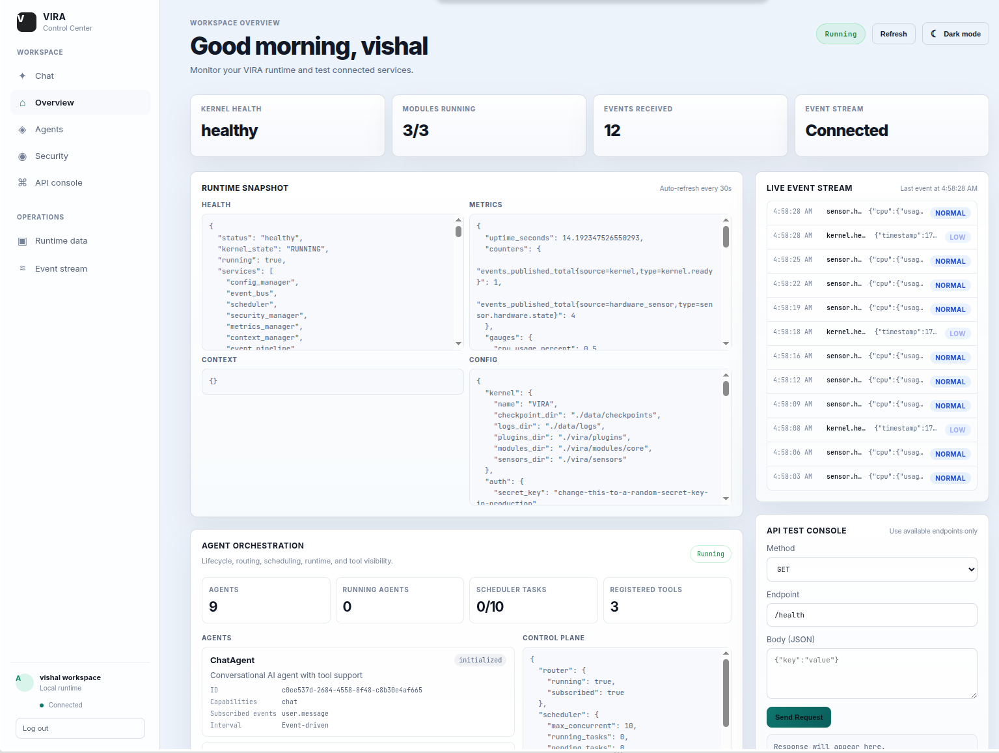

<div align="center">

# VIRA

**A local-first AI runtime and agent framework you can run on your own machine.**

[](#license)
[](#quick-start)
[](#requirements)
[](#the-default-model)

[Quick start](#quick-start) · [Docs](#documentation) · [Contributing](#contributing)

</div>



VIRA gives you a dashboard, a chat workspace, persistent memory, permissioned tools,
and a group of agents that can work on real tasks. Everything runs locally by default.
Ollama is the default provider. Cloud models are optional.

VIRA is the runtime underneath your own agents: it handles the conversation, memory,
event routing, permissions and tool execution so you can focus on the agent logic.

If you already have Ollama, the source quick start takes about five minutes.

---

## Try it

The fastest way is the AppImage. It is a pre-release build of the current `main` branch.

1. Download `VIRA-<version>-build<N>-x86_64.AppImage` and its `.sha256` from
   [Releases](https://github.com/Vishalsng112/VIRA/releases) or the latest
   *Build AppImage* Actions run.
2. Run it:

```bash
sha256sum -c VIRA-*-x86_64.AppImage.sha256   # optional
chmod +x VIRA-*-x86_64.AppImage
./VIRA-*-x86_64.AppImage
```

3. Open <http://localhost:8000> and create the admin account.

You still need Ollama running for local inference:

```bash
ollama pull ornith-1.5:9b
ollama serve
```

Your data and `config.yaml` live in `~/.local/share/vira`, outside the AppImage, so
they survive upgrades.

If the build is missing a feature you see here, run from source instead.

---

## Quick start

### Requirements

- Python 3.11+
- Git
- [Ollama](https://ollama.com/download)
- Bubblewrap (`bubblewrap`) if you want agent sandboxes

Linux is the primary platform right now. Windows and macOS support is planned through
containers.

### Run from source

```bash
git clone https://github.com/Vishalsng112/VIRA.git
cd VIRA

python -m venv .venv
source .venv/bin/activate          # Windows: .venv\Scripts\activate
pip install -r requirements.txt

ollama pull ornith-1.5:9b
ollama serve                       # if it is not already running

python run.py
```

Open <http://localhost:8000>. The first visit creates the admin account.

Optional sandbox setup:

```bash
sudo apt-get install bubblewrap
sudo mkdir -p /AgentWorkspace
sudo chown "$USER":"$USER" /AgentWorkspace
```

For local HTTP, keep `auth.https_only: false` in `config.yaml`. Turn it on before
exposing VIRA through HTTPS or a trusted reverse proxy.

---

## The default model

VIRA ships with **`ornith-1.5:9b`** through Ollama. This is the framework's final
default model choice, and the agents and prompts are tuned around it.

```bash
ollama pull ornith-1.5:9b
```

You can still use other Ollama models, OpenAI or Anthropic. Change
`llm.default_model` and the `llm.models` list in `config.yaml`.

---

## What you can do

### Chat and tools

The chat workspace keeps conversations and memory locally. The agent can use the
built-in tools: filesystem, shell, git, utility, web search/browse/research, and a
Bubblewrap-backed sandbox. Tool calls go through permissions and are audited.

### Operations

The dashboard exposes kernel health, modules, agents, tools, events, metrics and
configuration. You can inspect what the runtime is doing instead of guessing.

### Multi-user and multi-device

One VIRA server can serve several users and several endpoint devices. The server is
itself registered as a device, so local sensors use the same ingestion path as remote
clients. Device credentials are separate from user sessions, scoped, expiring and
revocable.

See [docs/MULTI_DEVICE_IMPLEMENTATION.md](docs/MULTI_DEVICE_IMPLEMENTATION.md) for the
current status and [VIRA_MULTI_DEVICE_DESIGN.md](VIRA_MULTI_DEVICE_DESIGN.md) for the
design.

### Device companion: VIRA Link

`client/` is **VIRA Link**, a modular Flutter client for Android, iOS, the web,
Linux and Windows. It signs in as a VIRA user, enrolls the device, captures only
the signals you enable, stores every event in a local outbox, and sends bounded
batches to the server when it is reachable. Offline capture keeps working; the
queue drains automatically on reconnect.

```bash
cd client
flutter pub get
flutter run -d chrome       # or android, linux
```

See [client/README.md](client/README.md) for the module layout and API contract.

---

## How it fits together

```
intent -> conversation + memory -> agent reasoning -> permissioned tools -> result
```

The kernel and sensors provide state. Agents use that state and the tool registry.
Everything is exposed through the authenticated API and dashboard.

---

## Project layout

```text
vira/kernel/                event bus, dispatcher, state, scheduler, security
vira/sensors/               system, hardware, process, network, workspace, activity
vira/agent/                 BaseAgent, runtime loop, tool calls
vira/agent_orchestration/   registry, router, workflows
vira/llm/                   Ollama, OpenAI and Anthropic adapters
vira/memory/                conversations, scoped memory, context assembly
vira/tools/                 registry, built-ins, MCP server, web tools
vira/api/                   FastAPI app and route modules
vira/auth/  vira/devices/   users, sessions, credentials, access grants
vira/web/static/            dashboard and chat pages
client/                     VIRA Link device companion (Flutter)
config.yaml                 runtime configuration
run.py                      start VIRA
```

## Documentation

- [docs/VIRA_DOCS.md](docs/VIRA_DOCS.md) — framework reference and config
- [docs/SYSTEM_DESIGN.md](docs/SYSTEM_DESIGN.md) — design and persistence
- [docs/AGENT_DESIGN.md](docs/AGENT_DESIGN.md)
- [docs/MULTI_DEVICE_IMPLEMENTATION.md](docs/MULTI_DEVICE_IMPLEMENTATION.md) and
  [VIRA_MULTI_DEVICE_DESIGN.md](VIRA_MULTI_DEVICE_DESIGN.md)
- [docs/VIRA_architecture.svg](docs/VIRA_architecture.svg) — diagram

---

## Configuration and security

`config.yaml` controls the provider, agents, sensors, tools and devices.
The dashboard can edit it and reload the runtime.

Before exposing VIRA beyond localhost: set a random `auth.secret_key`, enable
`auth.https_only` behind TLS, review tool permissions, and keep port 8000 behind a
reverse proxy.

The Bubblewrap sandbox is for development workloads, not hostile code. Use a
container or VM for a stronger boundary.

---

## Development status

This is a real system with rough edges, not a finished product. Linux is the primary
platform. APIs and config keys can still move.

Working: kernel, sensors, events, state, metrics, authenticated dashboard, chat,
memory, runs, agent lifecycle, local/MCP tools with permissions and auditing,
and multi-user accounts and devices.

Still open: better memory retrieval, run recovery, OS-native sensing, stronger
isolation, generated agents/tools with approval gates, and Windows/macOS packaging.

---

## Contributing

Issues and pull requests are welcome. You do not need to understand the whole runtime
to improve one part of it. Start with [CONTRIBUTING.md](CONTRIBUTING.md), or pick a
[`good first issue`](https://github.com/Vishalsng112/VIRA/issues?q=is%3Aissue+is%3Aopen+label%3A%22good+first+issue%22).

```bash
python -m pytest vira/tests
```

---

## License

MIT. See [LICENSE](LICENSE).
