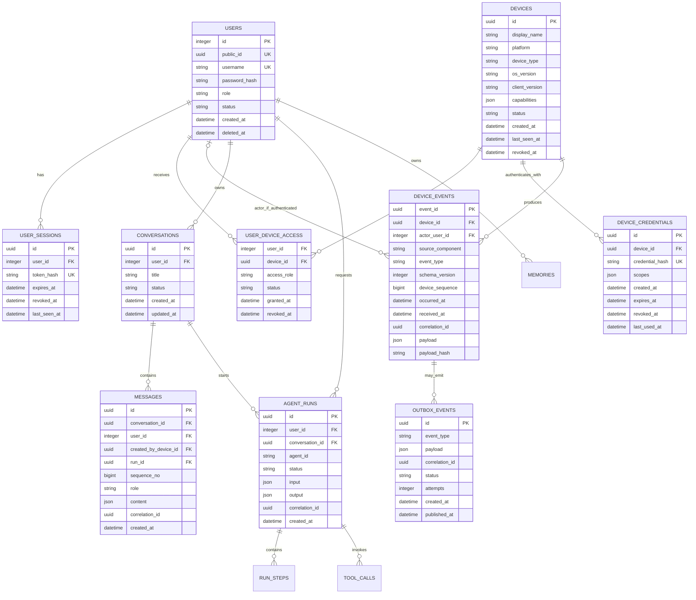
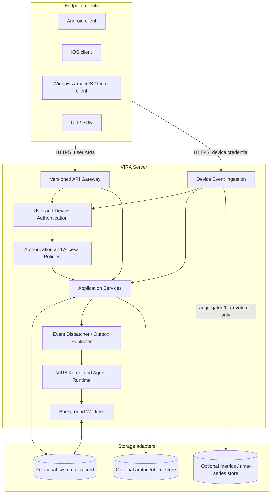

# VIRA Multi-User, Multi-Device Platform Design

**Status:** Proposed target design  
**Design rule:** Requirements → API contracts → entities and persistence → high-level design → low-level design → implementation and acceptance tests.  
**Scope:** One VIRA server installation supporting multiple users and multiple registered endpoint devices.  
**Compatibility note:** This is a target-state specification. The existing implementation is not yet compliant with it.

---

## 1. Executive Decision

VIRA is a **server-side platform with endpoint clients**, not an endpoint application that happens to expose an API. VIRA Server owns identity, authorization, device registration, event ingestion, persistence, agent orchestration, and administration. Android, iOS, Windows, macOS, Linux, and future clients connect to it through a versioned API and a platform-neutral event contract.

Keep these identities separate:

1. **Server installation** — one deployed VIRA service and its configuration.
2. **User** — a human account managed by an administrator.
3. **Device** — a registered physical or virtual endpoint running a VIRA client/agent.
4. **Device credential** — revocable authentication material proving which device is sending a request.
5. **User–device access** — an explicit association authorizing a user to interact with a device.
6. **Event source** — a sensor, app, subsystem, or client component on a device or the server.
7. **Event actor** — the authenticated user, device, or server component responsible for the event.

A user can use multiple devices. An installation can serve multiple users. A device can be associated with multiple users where sharing is explicitly authorized. A device may produce background telemetry when no human user is active; those events must have a device identity and a nullable user identity, not an invented user attribution.

**Administrator scope:** bootstrap and configure the installation; create, disable, and delete user accounts; manage account roles and, when authorized, revoke devices/sessions. The administrator is not the device, event source, or ordinary runtime actor. Administrative operations must be audited. The server itself does not authenticate as a human user.

## 2. Current-State Findings from the Repository

| Area | Current implementation observed | Gap to target |
|---|---|---|
| Identity | `users` and browser/API sessions live in `vira/auth/database.py`; `Principal` contains a user ID, role, and session ID. | No independent device principal or user–device access model. |
| User administration | Auth code supports initial admin creation, login/logout, and password recovery. | No admin API for listing, creating, disabling, or deleting users. |
| Device inventory | No `devices`, `device_credentials`, or user–device relationship table in the current schema. | Cannot reliably identify or revoke individual endpoint devices. |
| Event metadata | `vira/kernel/event_bus.py` has a free-form `source` string, event type, event ID, correlation ID, and timestamps. | No server-verified `device_id`, nullable `actor_user_id`, source component ID, device sequence, or device credential boundary. |
| Event ingress | `/events/publish` accepts a request-supplied `source`; it does not establish device identity. | A client-supplied source label is descriptive metadata, not authentication. |
| Event streams | `EventStreamManager.broadcast()` fans each event to all currently connected queues. | Authenticated users are not isolated by event ownership or device access. This must be fixed before multi-user deployment. |
| Sensor runtime | Sensors are instantiated inside the server kernel and publish locally. | Remote endpoint clients need an enrollment, authenticated ingress, heartbeat, and capability contract. |
| Database design | Existing SQLite schema has user-owned conversations, messages, runs, memories, sessions, and an outbox. | Device/event origin records are absent. Some documented target entities such as `RUN_STEPS` are not current tables. |
| Design/code alignment | `docs/SYSTEM_DESIGN.md` describes a target ERD using UUID user IDs, while current `users.id` is an auto-increment integer and current persistence differs from that ERD. | Explicitly label current vs target design and choose one migration-compatible identifier strategy. |
| Route versioning | Several API routes use `/api/v1`; other routes such as `/events/publish`, `/chat`, `/health`, and `/conversations` are unversioned. | Define a versioning and compatibility policy before adding clients. |

These findings justify a design-first iteration. Do not begin by adding a `device_id` field to the existing event object alone: identity, authorization, enrollment, storage, API behavior, and stream filtering must be designed together.

## 3. Scope and Assumptions

### In scope

- Multiple user accounts in one VIRA installation.
- Administrator-managed user lifecycle.
- Multiple registered devices per user.
- Explicit many-to-many user–device access, including shared devices if authorized.
- Platform-neutral device enrollment, authentication, heartbeats, capabilities, and event ingestion.
- Reliable event identity, provenance, deduplication, authorization, persistence, and observability.
- A server runtime that remains a modular monolith initially; endpoint clients use the same public contract.

### Not assumed for the first release

- SaaS-style multi-tenancy with multiple organizations in one database.
- A particular mobile framework or desktop client technology.
- That every sensor/capability is available on every operating system.
- Indefinite retention of high-volume raw telemetry.
- That all device events must be stored forever in the transactional database.

If workspaces/organizations or tenant-specific administrators are required, add those requirements before freezing the schema; do not silently treat a user as a tenant.

## 4. Functional Requirements

Priorities: **M** = mandatory for the first multi-device release; **S** = should; **L** = later.

### 4.1 Administration and identity

| ID | Requirement | Priority | Acceptance condition |
|---|---|---:|---|
| FR-ID-01 | Bootstrap the first administrator only when no administrator exists. | M | A second bootstrap attempt is rejected. |
| FR-ID-02 | An administrator can create a user with a role and initial credential/reset flow. | M | New user can authenticate after completing the configured activation flow. |
| FR-ID-03 | An administrator can list, inspect, disable/reactivate, and delete a user. | M | Every operation is authorized and audited; deleting/disabling the last active administrator is prevented unless a safe replacement exists. |
| FR-ID-04 | Users can authenticate, log out, change/reset credentials, and revoke sessions. | M | Revoked or expired sessions fail immediately. |
| FR-ID-05 | Every request resolves to a typed principal: user, device, or service principal. | M | Authorization does not infer identity from request-body fields. |
| FR-ID-06 | User data and devices are isolated by explicit access checks. | M | User A cannot access User B's conversations, memories, or devices without a grant. |
| FR-ID-07 | All administrative, authentication, enrollment, and revocation operations are auditable. | M | Audit record contains actor, action, target, outcome, time, and correlation ID without raw secrets. |

### 4.2 Device lifecycle

| ID | Requirement | Priority | Acceptance condition |
|---|---|---:|---|
| FR-DEV-01 | A signed-in user can register a device with a display name, platform, device type, client version, and capabilities. | M | Server creates a stable device ID and an initial user–device access row. |
| FR-DEV-02 | The server issues device-scoped credentials separate from user credentials. | M | Device credential is shown only at issuance, stored as a hash server-side, and can be rotated or revoked. |
| FR-DEV-03 | A user can list and inspect devices they are authorized to access. | M | Device lists never include unauthorized devices. |
| FR-DEV-04 | A user with sufficient permission or an administrator can rename, revoke, or remove device access. | M | Revocation prevents subsequent device-authenticated requests. |
| FR-DEV-05 | A device reports heartbeat, client version, platform/OS version, and capabilities. | M | Server records `last_seen_at` and device health independently of human activity. |
| FR-DEV-06 | A device may be associated with multiple users through explicit grants; a user may have multiple devices. | M | Relationship is many-to-many and independently revocable. |
| FR-DEV-07 | Device state supports `pending`, `active`, `revoked`, and `retired` lifecycle states. | M | State transitions are validated and audited. |
| FR-DEV-08 | A device can report that a capability is unavailable or permission-denied on its platform. | S | Capability negotiation does not assume desktop-only sensors exist on mobile. |

### 4.3 Event provenance and processing

| ID | Requirement | Priority | Acceptance condition |
|---|---|---:|---|
| FR-EVT-01 | Every accepted endpoint event is attributed to an authenticated device. | M | `device_id` is resolved from device credentials, not trusted from the payload. |
| FR-EVT-02 | An event records its source component and event type separately from the device identity. | M | Two sensors on one device are distinguishable. |
| FR-EVT-03 | Event actor user identity is optional and set only when backed by authenticated user context and valid device access. | M | Background sensor events can have `actor_user_id = NULL`. |
| FR-EVT-04 | Event ingestion accepts batches and is idempotent by event ID. | M | Retry of the same event does not create a duplicate durable event or duplicate side effect. |
| FR-EVT-05 | Events record client occurrence time and server receipt time. | M | Clock skew and delayed/offline delivery can be diagnosed. |
| FR-EVT-06 | Events include schema version, correlation ID, optional causation ID, and per-device sequence where available. | M | Schema evolution, tracing, and ordering diagnostics are supported. |
| FR-EVT-07 | Durable state changes use an outbox; consumers support retries and deduplication. | M | A committed event-producing transaction is not lost on process restart. |
| FR-EVT-08 | Event streams are filtered by the caller's user/device permissions. | M | No event is broadcast to unrelated users. |
| FR-EVT-09 | High-volume metrics are sampled, aggregated, or stored separately from chat data. | M | Message tables do not become a telemetry data lake. |
| FR-EVT-10 | Operators can view event ingest failures, device last-seen state, event lag, and dead-letter counts. | S | Health and failure status are actionable without exposing unrelated user payloads. |

### 4.4 Existing VIRA capabilities retained

| ID | Requirement | Priority |
|---|---|---:|
| FR-APP-01 | Existing conversations, messages, runs, memories, agents, and tools continue to work through application services. | M |
| FR-APP-02 | Chat messages can record the submitting device when a request includes a validated device context. | M |
| FR-APP-03 | Run, message, event, and tool traces share correlation IDs where a causal relationship exists. | M |
| FR-APP-04 | Local single-device deployments remain usable without forcing an external broker or time-series database. | M |

## 5. Non-Functional Requirements

Targets below are proposed starting points and must be validated with a representative deployment and expected traffic. They are not claims about current performance.

| ID | Attribute | Requirement / target | Verification |
|---|---|---|---|
| NFR-SEC-01 | Authentication | User credentials, device credentials, and service credentials are distinct; credentials are revocable and never logged. | Security tests and log review. |
| NFR-SEC-02 | Authorization | Deny by default; ownership/access predicates enforced in application services/repositories, not only UI routes. | Cross-user and cross-device negative tests. |
| NFR-SEC-03 | Transport | Remote client/server traffic uses TLS; browser cookies retain CSRF protections appropriate to the chosen auth flow. | Deployment and API tests. |
| NFR-SEC-04 | Secret storage | Store password hashes and device credential hashes or public-key material; return raw device secrets only once. | Database inspection and credential-rotation tests. |
| NFR-PRIV-01 | Privacy | Event payloads are minimized; per-event retention and deletion policy is configurable; user-specific streams are isolated. | Privacy tests and retention jobs. |
| NFR-DUR-01 | Durability | Committed identity, device, message, run, audit, and durable event records survive process restart. | Restart/recovery tests. |
| NFR-REL-01 | Delivery | Device clients may retry batches; duplicate event IDs are safe; transient failures expose retryable responses. | Fault injection and replay tests. |
| NFR-PERF-01 | API performance | Non-LLM API requests target p95 below 300 ms at the agreed reference load. | Load test; exclude LLM provider latency. |
| NFR-PERF-02 | Ingest performance | Batch acknowledgement targets p95 below 500 ms at the agreed reference event rate. | Load test using realistic event payloads. |
| NFR-OBS-01 | Observability | Every request/event/run can be traced by correlation ID; logs include server receipt time and resolved source identity. | Trace propagation tests. |
| NFR-SCALE-01 | Scale-out | API and worker processes can be separated without changing domain contracts. | Integration test with separate API/worker process. |
| NFR-MAINT-01 | Architecture | Transport routes call application services; services depend on repository/event ports; persistence stays in adapters. | Dependency checks and unit tests. |
| NFR-PORT-01 | Portability | Same API/event schema is used by Android, iOS, Windows, macOS, and Linux clients. | Shared contract test suite. |
| NFR-COMP-01 | Compatibility | Event payloads are versioned and unknown optional fields do not break consumers. | Contract/version compatibility tests. |

Before performance sign-off, the product owner must define the expected active users, registered devices, event rate per device, retention period, and peak concurrent connections. Then convert those values into fixed load-test profiles.

## 6. Canonical Domain Model and Data Ownership

### 6.1 Entity relationship diagram



### 6.2 Entity definitions and constraints

| Entity | Source of truth | Essential fields / rules |
|---|---|---|
| `users` | Account lifecycle | Existing integer `id` remains the internal FK for migration compatibility; add immutable UUID `public_id` for external references. Never accept a role claim directly from a client. |
| `user_sessions` (current `sessions`) | Human identity | User session token hash, expiry, revocation, last-seen. A user session is not a device credential. |
| `devices` | Registered endpoint identity | Server-generated UUID; platform and type enums; status; client/OS versions; capability document; first/last seen. No raw secrets. |
| `device_credentials` | Device authentication | Hashed opaque token or public-key record, scope, expiry, revocation, rotation lineage. A credential belongs to one device. |
| `user_device_access` | Authorization between user and device | Composite key `(user_id, device_id)` or surrogate key plus unique constraint; `owner`, `operator`, or `viewer` access; grant/revoke timestamps. |
| `device_events` | Durable event provenance | Unique `event_id`; device FK resolved from credential; optional actor user FK; source component; event type/version; client and server times; sequence; payload hash. |
| `conversations` / `messages` | Chat history | Retain current ownership and ordering constraints. Add nullable `created_by_device_id` to messages. |
| `agent_runs` / `run_steps` / `tool_calls` | Execution and audit | Preserve run lifecycle and tool authorization. Create `run_steps` only when implementation and migrations actually support it. |
| `memories` | User/agent context | User scope mandatory unless a separate explicitly defined system scope exists; preserve ownership filters. |
| `outbox_events` / `event_consumptions` | Reliable event publication | Commit outbox entry in the same transaction as a durable state change; deduplicate per consumer/event. |

### 6.3 ID and schema consistency decision

To avoid a destructive first migration, retain the current integer `users.id` as the internal relational key and add `users.public_id UUID UNIQUE NOT NULL` for external API references. New device, event, conversation, run, message, and correlation identifiers use UUIDs. Repository code maps `public_id` to the internal integer only after authentication. If a full UUID migration is chosen instead, it must be a separate ADR with a tested migration plan; do not mix both strategies accidentally.

All timestamps are stored in UTC. On PostgreSQL use `timestamptz`; on SQLite use a consistent ISO-8601 UTC representation. Use explicit migrations rather than relying only on `CREATE TABLE IF NOT EXISTS` statements. Index at least:

```sql
CREATE UNIQUE INDEX devices_credentials_hash_uq
  ON device_credentials(credential_hash);
CREATE INDEX user_device_access_by_user
  ON user_device_access(user_id, status, device_id);
CREATE INDEX user_device_access_by_device
  ON user_device_access(device_id, status, user_id);
CREATE INDEX device_events_by_device_time
  ON device_events(device_id, occurred_at DESC);
CREATE INDEX device_events_by_actor_time
  ON device_events(actor_user_id, occurred_at DESC);
CREATE INDEX device_events_by_type_time
  ON device_events(event_type, received_at DESC);
CREATE INDEX messages_conversation_sequence
  ON messages(conversation_id, sequence_no);
```

Adapt index syntax and UUID types to SQLite/PostgreSQL migrations. Add a unique constraint for `device_events.event_id`; if a device sequence is guaranteed monotonic by the client, add unique `(device_id, device_sequence)` only where the sequence semantics are stable across client reinstalls.

### 6.4 Storage policy

- **Relational database:** users, sessions, device inventory/access, credential hashes, durable event metadata, conversations, messages, runs, memories, audit records, and outbox.
- **Local mode:** SQLite is acceptable for a single process/single installation with controlled write concurrency.
- **Production multi-process mode:** PostgreSQL is the system of record; use migrations and transactional repositories.
- **High-volume metrics/raw telemetry:** begin with bounded retention and batching. Add a time-series/columnar store only when event rate and query patterns justify it.
- **Large artifacts:** file/object storage, not rows in `messages` or `device_events`.
- **Never** use the event bus, in-memory dictionary, or Redis cache as the only durable record of an accepted durable event.

## 7. API Design

All public endpoints use `/api/v1`. The HTML dashboard may remain outside this prefix. Existing unversioned endpoints should be treated as legacy adapters and migrated/deprecated explicitly, not copied into new clients.

### 7.1 Authentication and principal types

- `UserPrincipal`: `user_id` (internal), `user_public_id`, roles, session ID.
- `DevicePrincipal`: `device_id`, credential ID, allowed scopes, device status.
- `ServicePrincipal`: service identity and narrowly scoped permissions for workers/internal components.

Do not allow a device credential to call user administration APIs. Do not allow a user session alone to impersonate a device. Device endpoints derive `device_id` from the validated credential and must reject a mismatch between the credential and any device ID in the path.

### 7.2 Endpoint catalog

| Method | Endpoint | Principal | Purpose |
|---|---|---|---|
| `POST` | `/auth/bootstrap` | Unauthenticated, only before bootstrap | Create the first administrator once. |
| `POST` | `/auth/login` | Public | Authenticate a human user. |
| `POST` | `/auth/logout` | User | Revoke current session. |
| `GET` | `/auth/me` | User | Return current account and role metadata. |
| `GET` | `/admin/users` | Admin | List users with cursor pagination. |
| `POST` | `/admin/users` | Admin | Create a user and issue activation/reset flow. |
| `GET` | `/admin/users/{user_public_id}` | Admin | Inspect account status and roles. |
| `PATCH` | `/admin/users/{user_public_id}` | Admin | Update allowed fields, role, or active status. |
| `DELETE` | `/admin/users/{user_public_id}` | Admin | Soft-delete/deactivate by default; hard deletion is a separately authorized retention operation. |
| `POST` | `/devices` | User | Register a device; bind initial access to the authenticated user; issue device credential once. |
| `GET` | `/devices` | User | List devices the user may access. |
| `GET` | `/devices/{device_id}` | User with device access or Admin | Device metadata and status, never the raw credential. |
| `PATCH` | `/devices/{device_id}` | Device owner/Admin | Rename or update allowed metadata. |
| `POST` | `/devices/{device_id}/credentials:rotate` | Device owner/Admin with step-up auth where supported | Revoke old credential and issue a new one. |
| `POST` | `/devices/{device_id}/revoke` | Device owner/Admin | Revoke device and all its credentials. |
| `POST` | `/devices/{device_id}/access` | Device owner/Admin | Grant a user `owner`, `operator`, or `viewer` access. |
| `DELETE` | `/devices/{device_id}/access/{user_public_id}` | Device owner/Admin | Revoke a user's access to a shared device. |
| `POST` | `/devices/{device_id}/heartbeat` | Device | Report liveness, client version, OS version, and capabilities. |
| `POST` | `/devices/{device_id}/events:batch` | Device with `events:write` scope | Batch ingest endpoint-generated events. |
| `GET` | `/devices/{device_id}/events` | User with device access or Admin | Read permitted event metadata with cursor pagination. |
| `GET` | `/events/stream` | User | Stream only events visible to this user. |
| `GET` | `/conversations` | User | List only conversations owned by the user or explicitly shared. |
| `POST` | `/conversations/{conversation_id}/messages` | User | Submit a message; optional device context is separately validated. |
| `GET` | `/runs/{run_id}` | Authorized user | Read a run only if the principal owns or is authorized for it. |

Status codes: `201` for newly created resources, `202` for accepted asynchronous work, `200` for reads/updates, `204` for successful no-body revocations/deletions, `400` for invalid shape, `401` for missing/invalid authentication, `403` for insufficient permission, `404` for absent or deliberately concealed inaccessible resources, `409` for state/idempotency conflicts, `422` for schema validation, and `429` for rate limiting.

### 7.3 Device registration contract

`POST /api/v1/devices` requires a user session and accepts fields such as:

```json
{
  "display_name": "Personal Android",
  "platform": "android",
  "device_type": "phone",
  "os_version": "client-reported version",
  "client_version": "1.0.0",
  "capabilities": ["notifications", "activity_events"]
}
```

The server generates `device_id`, records the caller's user–device grant, and returns device metadata plus a newly generated credential **once**. The raw credential must never appear in later list/detail responses or logs. Store it in the platform's secure credential store (Android Keystore, iOS Keychain, or OS-specific credential storage). The server stores only a hash or public-key verifier. Device credentials must be rotatable and revocable independently of user sessions.

The above payload is illustrative. The client must not choose its authoritative `device_id`, user ID, role, credential scope, or active/revoked state.

### 7.4 Event ingestion contract

`POST /api/v1/devices/{device_id}/events:batch` uses a **device credential** with `events:write` scope. Body example:

```json
{
  "events": [
    {
      "event_id": "0192d3b4-1111-7111-8111-111111111111",
      "type": "device.process.snapshot",
      "schema_version": 1,
      "occurred_at": "2026-10-29T01:30:00Z",
      "source_component": "process-monitor",
      "source_instance_id": "process-monitor-v1",
      "device_sequence": 1842,
      "correlation_id": "0192d3b4-2222-7222-8222-222222222222",
      "payload": {"process_count": 73}
    }
  ]
}
```

The server derives `device_id` from the credential, `received_at` from its own clock, and the human actor only from separately authenticated user context. Device telemetry must not be allowed to submit an arbitrary `actor_user_id`. For a user action (such as sending a chat message), the user API principal establishes the user identity; an optional device ID is accepted only after checking `user_device_access`.

Return aggregate counts such as `accepted`, `duplicates`, and `rejected`, plus per-item stable error codes. Limit batch size and payload bytes. Validate event type, schema version, timestamps, and required fields. Do not accept arbitrary event types that can trigger privileged commands.

### 7.5 Canonical stored event envelope

After authentication and validation, event handling creates a normalized envelope containing:

```json
{
  "event_id": "uuid",
  "type": "device.process.snapshot",
  "kind": "domain",
  "schema_version": 1,
  "source": {
    "kind": "sensor",
    "component_id": "process-monitor",
    "instance_id": "process-monitor-v1"
  },
  "device_id": "server-resolved-device-uuid",
  "actor_user_id": null,
  "occurred_at": "2026-10-29T01:30:00Z",
  "received_at": "server-generated-UTC-time",
  "device_sequence": 1842,
  "correlation_id": "uuid",
  "causation_id": null,
  "payload": {"process_count": 73}
}
```

`device_id`, `actor_user_id`, and `received_at` are resolved by the server; the payload shown is a normalized internal representation, not a set of trusted client claims. Keep `source_component` separate from `device_id`: a laptop's process sensor and filesystem sensor are two sources on one device.

### 7.6 Consistent API conventions

- Use `/api/v1` for every public JSON/API/SSE endpoint.
- Use stable UUIDs for public device/event/resource identifiers and `users.public_id` for user references.
- Use UTC ISO-8601 timestamps; store both client occurrence and server receipt time for device events.
- Use cursor pagination for event/device/message lists.
- Require `Idempotency-Key` for retriable mutation requests where request-level idempotence is needed; use `event_id` for event-level deduplication.
- Generate a `correlation_id` server-side if absent; never treat it as authentication.
- Use a consistent error object with machine-readable `code`, safe `message`, and `correlation_id`.
- Avoid leaking whether an inaccessible resource exists when that would disclose another user's data.

## 8. High-Level Design (HLD)

### 8.1 Logical architecture



### 8.2 Component responsibilities

- **Endpoint client/agent:** gathers only platform-permitted capabilities, sends heartbeats and bounded event batches, handles retries, maintains a per-device sequence when feasible, and stores credentials in OS-secure storage. It does not decide the authoritative user/device identity.
- **API gateway:** versioning, request validation, rate limiting, error mapping, correlation IDs, and transport-specific concerns. It contains no business persistence rules.
- **Authentication:** resolves user sessions, device credentials, and service identities into different typed principals.
- **Authorization:** verifies role plus resource ownership/access on every request and stream subscription.
- **Device service:** registration, capabilities, status, access grants, credential rotation, and revocation.
- **Event ingestion service:** validates type/schema/size, resolves provenance, deduplicates, persists durable events, and writes outbox rows transactionally.
- **Application services:** users, conversations, messages, runs, memories, agents, and tools.
- **Kernel/event adapters:** route normalized events to local subscribers or a durable broker. A local in-process bus is an adapter, not the multi-process source of truth.
- **Repositories/migrations:** own SQL and constraints; provide SQLite and PostgreSQL adapters where required.
- **Operations service:** metrics, event lag, device health, failed deliveries, and admin audit views with access filtering.

### 8.3 Deployment modes

**Local development:** FastAPI + kernel/worker in one process, SQLite WAL, local event bus, local artifact storage. The same device and user contracts are enforced even when server and client run on the same computer.

**Multi-user production:** FastAPI/API processes + worker processes, PostgreSQL system of record, transactional outbox, durable broker/stream where cross-process delivery is needed, metrics/time-series storage only when justified, TLS termination, backups, and explicit credential/secret configuration.

Do not require a microservice split to achieve multi-device support. Start with a modular monolith and extract independently scalable components only when load and operational needs justify it.

## 9. Low-Level Design (LLD)

### 9.1 Proposed package boundaries

```text
vira/
  domain/
    identity.py             # UserPrincipal, DevicePrincipal, ServicePrincipal
    device.py               # Device, DeviceCredential, UserDeviceAccess
    event.py                # normalized EventEnvelope and schema metadata
  application/
    users/                  # create, list, deactivate, delete users
    devices/                # register, heartbeat, grant, revoke, rotate
    events/                 # ingest batch, dedupe, authorize, dispatch
    conversations/          # existing chat use cases
    ports.py                # repository and publisher protocols
  api/
    routes/
      auth.py
      admin_users.py
      devices.py
      device_events.py
      conversations.py
      operations.py
    dependencies.py         # typed principal and resource authorization
  infrastructure/
    persistence/
      migrations/
      sqlite/
      postgres/
      repositories.py
    events/
      local_bus.py
      outbox_publisher.py
      broker_adapter.py     # optional production adapter
  clients/
    contract/               # shared schema examples and conformance tests
```

This is a target structure, not a requirement to relocate every existing Python module in the first commit. Existing `vira/auth`, `vira/kernel`, and `vira/api` can be adapted incrementally while preserving their public contracts behind application services.

### 9.2 Ingest transaction and idempotency

For each batch:

1. Authenticate the device credential and resolve its `device_id`, state, and scopes.
2. Confirm the path device ID matches the credential's device ID and that the device is active.
3. Validate batch size, event schema, payload size, timestamp, event type allow-list, and supported schema version.
4. For each item, compute/verify a canonical payload hash and attempt to insert by unique `event_id`.
5. If the ID already exists with the same hash, report it as a duplicate and do not repeat side effects. If the same ID has a different hash, return a conflict and record a security diagnostic.
6. For durable event types, insert the normalized event row and its outbox record in the same transaction.
7. Commit before acknowledging acceptance. Return item-level results.
8. The outbox publisher retries transient failures with bounded backoff; consumers record `(consumer_name, event_id)` after successful handling.
9. Update device heartbeat/last-seen independently of whether a specific event is a duplicate, provided the authenticated request is valid.

Acknowledge at-least-once delivery with idempotent processing, not an unsupported promise of exactly-once delivery across a network. Event occurrence time is not a strict global ordering guarantee; use device sequence and receipt time to diagnose reordering.

### 9.3 Authorization rules

- `admin`: manage accounts and installation operations; device visibility is explicit unless the operations policy grants fleet-wide access.
- `user`: access owned resources and devices granted through `user_device_access`.
- `device`: write only to device-scoped endpoints permitted by credential scopes; cannot call user/admin routes.
- `service`: narrowly scoped internal permissions; no use of a human session cookie.
- User–device access roles: `owner` can manage grants and revoke; `operator` can use permitted capabilities; `viewer` can inspect allowed status/events. Exact capability actions are policy-controlled.
- Every repository operation accepting a user-scoped resource must include ownership/access predicates. Never fetch by ID and rely on the UI to hide unauthorized records.
- Event stream subscriptions must apply the same ACL as event list APIs. Never broadcast all events to every authenticated SSE queue.

### 9.4 State machines

**Device:** `pending → active → revoked → retired`; revocation is terminal for that credential. Re-enrollment creates or explicitly reactivates a device according to policy; it must not silently restore a leaked credential.

**User:** `invited/pending → active → disabled → deleted`; disabled users cannot create sessions. Deletion policy must specify what happens to conversations, memories, events, audit records, and ownership. Prefer deactivation/tombstone first, followed by an explicit retention/deletion workflow.

**Event delivery:** `received → persisted → pending_dispatch → published`; failed publication goes through bounded retry and then `dead_letter`. Duplicate receipt does not create a second durable event.

### 9.5 Error and retry rules

- `401`: missing, invalid, expired, or revoked credential.
- `403`: valid principal but insufficient scope/role.
- `404`: unknown resource or concealed inaccessible resource.
- `409`: event ID reused with different payload, invalid state transition, or conflicting enrollment.
- `413`: request or batch exceeds configured payload limit.
- `422`: invalid event shape/schema/version.
- `429`: device/user rate limit exceeded; include retry guidance when safe.
- `5xx`: transient server-side failure; client retries with jitter and stable event IDs.

Never return credential hashes, raw tokens, password hashes, private sensor content, or unredacted tool/LLM secrets in errors or audit logs.

## 10. Requirement-to-Design Traceability

| Requirement family | API contract | Entities | HLD component | LLD implementation | Essential tests |
|---|---|---|---|---|---|
| FR-ID-01–07 | `/auth/*`, `/admin/users/*` | `users`, `user_sessions`, `auth_audit` | Authentication, Authorization, Admin API | `UserAdminService`, auth dependencies, repositories | bootstrap-once, last-admin protection, disabled/revoked session, audit records |
| FR-DEV-01–08 | `/devices*`, `/devices/{id}/access*` | `devices`, `device_credentials`, `user_device_access` | Device service, API, Authorization | `DeviceService`, credential repository, migration | multiple devices/user, shared grant, revocation, unsupported capability |
| FR-EVT-01–10 | `/devices/{id}/events:batch`, `/events/stream` | `device_events`, `outbox_events`, `event_consumptions` | Ingestion, dispatcher, operations | `EventIngestionService`, publisher, event repository | spoof rejection, idempotent retry, stream isolation, outbox recovery |
| FR-APP-01–04 | `/conversations*`, `/runs*`, `/memories*` | current chat/runtime entities plus device FK on messages | Application services, agent runtime | existing repositories/services with access checks | regression, user isolation, correct submitting device |
| NFR-SEC-* | all protected APIs | identity and audit entities | AuthN/AuthZ | typed principals, scopes, policy checks | negative authorization and secret-leak tests |
| NFR-DUR-01 / REL-01 | device batch and durable mutation APIs | event journal + outbox | DB + outbox + worker | transaction and idempotency logic | restart, duplicate replay, transient broker failure |
| NFR-PORT-01 / COMP-01 | versioned device/event schemas | devices, event schema version | client adapters | contract schema and conformance suite | Android/iOS/desktop contract tests and compatibility tests |

A requirement is not complete until it appears in the API contract, is supported by the schema, has an owning component, has a concrete LLD implementation, and has at least one acceptance test.

## 11. Security, Privacy, and Operations

- Separate user and device authentication schemes and scopes. A lost phone/laptop must be revocable without changing the user's password or logging out every other device.
- Keep device credentials in OS-secure storage and use TLS for all remote connections.
- Apply rate limits by user, device, and endpoint; cap batch count, payload size, and event types.
- Record device-created-at and server-received-at timestamps; treat client clock and payload values as untrusted input.
- Minimize sensitive payloads by default. Define per-event retention and export/deletion rules before collecting screen, application, file, or activity data.
- Device admin APIs should expose metadata and health by default, not raw activity payloads. Raw event access needs an explicit permission and audit trail.
- Add health fields: `last_seen_at`, latest client version, credential status, ingest error count, last accepted sequence, queue/backlog where reported, and capability health.
- Ensure logs and dashboards scope data to authorized administrators/users and do not become a cross-user side channel.

## 12. Migration and Delivery Sequence

This sequence intentionally follows dependency order. Do not implement endpoint clients before the server identity/event contracts are stable.

### Phase 0 — Requirements and baseline

1. Confirm user roles, sharing model, target platforms, event classes, retention, expected users/devices/events, and admin capabilities.
2. Mark existing features as retained, changed, or deprecated.
3. Freeze the FR/NFR IDs and acceptance criteria in this document.
4. Add tests reproducing existing event-stream cross-user exposure and API authorization behavior before changing them.

### Phase 1 — API and entity contracts

1. Approve `UserPrincipal`, `DevicePrincipal`, and `ServicePrincipal` semantics.
2. Approve device enrollment, user–device grant, credential rotation, revocation, heartbeat, and event-batch schemas.
3. Approve the canonical event envelope and event type/schema version policy.
4. Update ERD and SQL migration drafts; verify every API foreign key has a corresponding entity and every entity has an owner/use case.
5. Generate/validate OpenAPI schemas and example payloads from the same Pydantic/API schema definitions where possible.

### Phase 2 — Persistence and identity

1. Add `users.public_id`, device, credential, access-grant, and event-provenance tables with reversible/forward-tested migrations.
2. Add repository ports and SQLite implementation; add PostgreSQL implementation when production multi-process deployment is required.
3. Implement admin user CRUD with soft-delete/deactivate policy, last-admin protection, and audit records.
4. Implement distinct user/device authentication dependencies and credential revocation.

### Phase 3 — Event ingress and isolation

1. Implement device registration, heartbeat, access grants, and credential lifecycle.
2. Implement versioned batch ingest, payload validation, deduplication, durable event records, and outbox.
3. Fix event stream isolation and resource authorization before exposing remote endpoints.
4. Add rate limits, payload caps, health metrics, and dead-letter visibility.

### Phase 4 — Endpoint clients

1. Build one reference client/SDK and a contract conformance suite.
2. Implement platform adapters for Android/iOS/Windows/macOS/Linux according to actual OS permissions and capabilities.
3. Add offline queueing and backoff without changing the server event contract.
4. Validate per-device credential storage and remote revocation on each platform.

### Phase 5 — Production readiness

1. Run multi-user/multi-device authorization tests and sustained/peak load tests.
2. Verify backup, restore, restart recovery, outbox retry, and database migration.
3. Configure TLS, secure secret handling, retention, rate limits, and alerts.
4. Update `SYSTEM_DESIGN.md`, `VIRA_DOCS.md`, diagrams, OpenAPI, and implementation-status claims to describe the same target and shipped behavior.

## 13. Definition of Done

- [ ] Requirements and provisional performance targets are approved.
- [ ] API schemas and canonical event envelope are versioned and validated.
- [ ] ERD and migrations cover every entity referenced by the API and HLD.
- [ ] Multiple user accounts can coexist; only administrators can perform account administration.
- [ ] One user can register multiple devices; device access can be granted/revoked independently.
- [ ] Device credentials are distinct from user sessions, stored safely, scoped, rotatable, and revocable.
- [ ] Every stored endpoint event has authenticated device provenance and source component metadata.
- [ ] Human actor attribution is nullable and never trusted from an unauthenticated payload field.
- [ ] Replaying an event is safe; conflicting reuse of an event ID is rejected and audited.
- [ ] Event streams and APIs cannot disclose another user's or device's data.
- [ ] Existing chat, runs, memories, agents, and tools pass regression tests under multi-user isolation.
- [ ] Requirements, API, ERD, HLD, LLD, and acceptance tests have an explicit traceability mapping.
- [ ] Documentation distinguishes implemented behavior from target-state design.

---

## Appendix A — Key Design Rules

1. **VIRA Server is the platform; clients are endpoints.** Endpoint collection runs on devices; central identity, policy, persistence, and orchestration run on the server.
2. **A username is not a device identity.** A device ID is not proof of device identity either; its credential proves that identity.
3. **`source` is not authentication.** It is descriptive metadata. Device identity is derived from validated credentials.
4. **User identity is not inferred from device ownership.** Background events can have no user actor; interactive actions use authenticated user context.
5. **Authorization is evaluated at every resource boundary, including streams.** Authentication alone never grants access to all events.
6. **Events are first-class data.** Define event IDs, schema version, source, device/user attribution, timing, retention, deduplication, and delivery semantics before building clients.
7. **One canonical design across artifacts.** API, schema, HLD, LLD, tests, and docs must evolve from the same requirement IDs and contract definitions.
