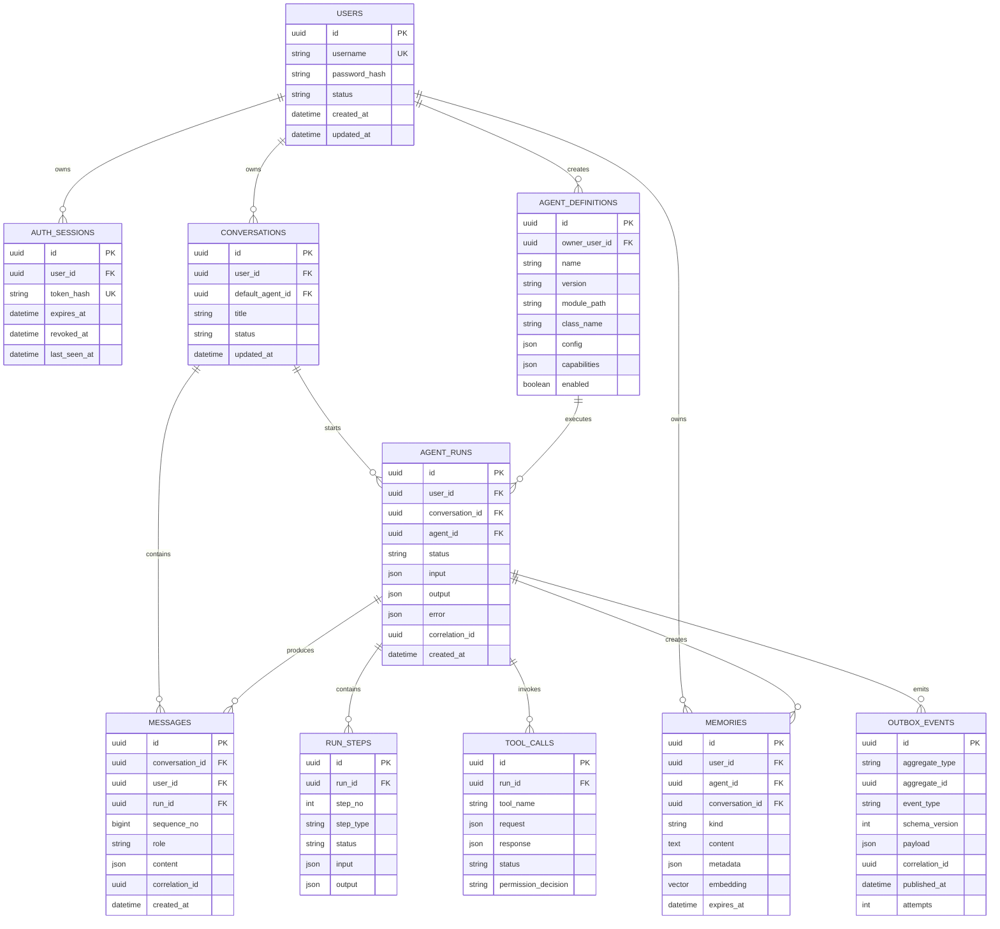
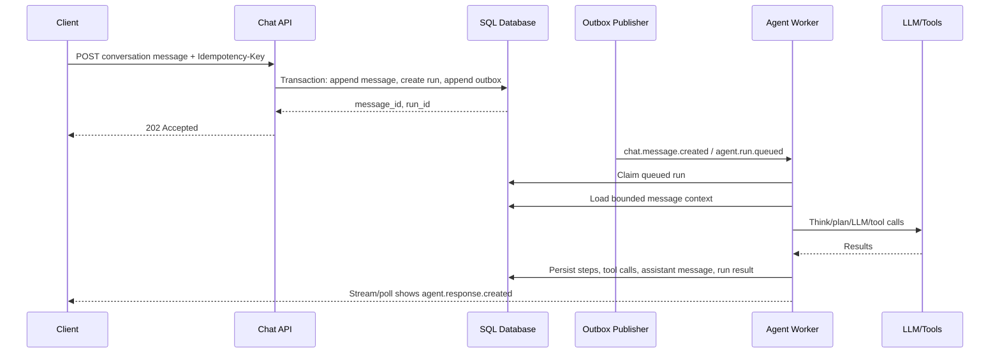
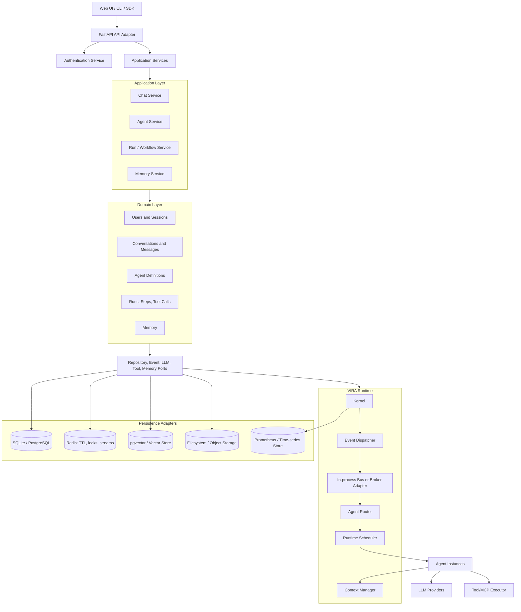
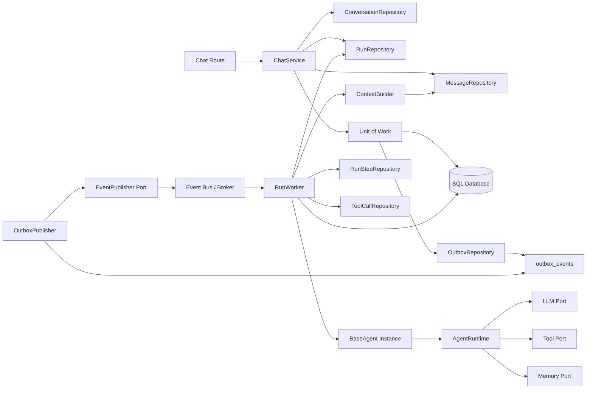
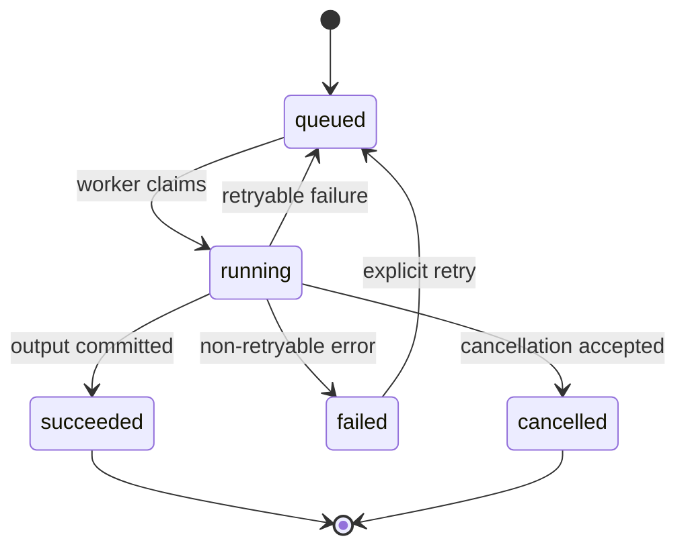

# VIRA System Design

## Purpose

This document defines the target architecture for VIRA. It focuses on users, conversations, agents, workflows, memory, events and database selection. The design keeps VIRA as a modular monolith
first and allows individual runtime components to scale independently later.

### Current implementation summary

VIRA is an asynchronous Python application composed of:

- FastAPI HTTP routes in [`vira/api/app.py`](../vira/api/app.py)
- Kernel lifecycle and event processing in [`vira/kernel/`](../vira/kernel/)
- Agents and lifecycle contracts in [`vira/agent/`](../vira/agent/)
- Agent routing and scheduling in [`vira/agent_orchestration/`](../vira/agent_orchestration/)
- LLM and tool access through [`vira/agent_runtime/`](../vira/agent_runtime/)
- Authentication and SQLite access in [`vira/auth/`](../vira/auth/)
- A currently stubbed memory subsystem in [`vira/memory/manager.py`](../vira/memory/manager.py)

The current system persists users, hashed sessions, roles, and authentication
audit events.
Conversation history is process-local in `ChatAgent`, agent registry state is
in memory, and the memory manager does not yet persist data.

---

## 1. Functional Requirements

### 1.1 Identity and access

| ID | Requirement | Priority |
|---|---|---|
| FR-01 | A user can create the initial administrator account. | Must |
| FR-02 | A user can log in and log out. | Must |
| FR-03 | A user can reset a password using a recovery code. | Must |
| FR-04 | Every authenticated request has a typed principal containing `user_id`, roles, and session ID. | Must |
| FR-05 | Users can only access their own conversations, runs, memories, and agents unless explicitly shared. | Must |
| FR-06 | Sessions can expire and be revoked. | Should |
| FR-07 | Authentication and authorization decisions are auditable. | Should |

### 1.2 Conversations and chat

| ID | Requirement | Priority |
|---|---|---|
| FR-08 | A user can create, list, rename, archive, and delete conversations. | Must |
| FR-09 | A user can append messages to a conversation. | Must |
| FR-10 | Messages preserve role, ordering, timestamps, correlation ID, and optional run ID. | Must |
| FR-11 | Chat history survives process restarts. | Must |
| FR-12 | Chat history is paginated and bounded before being sent to an LLM. | Must |
| FR-13 | A message submission is idempotent using a client idempotency key. | Must |
| FR-14 | The user can observe run status and receive assistant responses through polling or streaming. | Must |
| FR-15 | The system can retain system, assistant, user, and tool messages. | Should |

### 1.3 Agents and tools

| ID | Requirement | Priority |
|---|---|---|
| FR-16 | Agents implement the existing `think -> plan -> act -> reflect` contract. | Must |
| FR-17 | Agent definitions are versioned and persisted independently from loaded Python instances. | Must |
| FR-18 | Agents expose capabilities, input schemas, output schemas, and subscribed events. | Must |
| FR-19 | The system can enable, disable, register, and unregister agents. | Must |
| FR-20 | Tool calls are permission checked before execution. | Must |
| FR-21 | Every tool call records request, result, status, permission decision, and duration. | Must |
| FR-22 | User-created agent modules are allow-listed and run with restricted permissions. | Must |

### 1.4 Workflows and execution

| ID | Requirement | Priority |
|---|---|---|
| FR-23 | A user request creates a durable agent run. | Must |
| FR-24 | A run records lifecycle state: queued, running, succeeded, failed, cancelled. | Must |
| FR-25 | A run records individual think, plan, LLM, tool, and reflect steps. | Must |
| FR-26 | Worker failure does not silently lose a run. | Must |
| FR-27 | Stale running jobs can be retried or marked failed. | Must |
| FR-28 | Workflows can execute ordered or DAG-based agent steps. | Should |
| FR-29 | Run cancellation is propagated to the scheduler and active tools where possible. | Should |

### 1.5 Memory and context

| ID | Requirement | Priority |
|---|---|---|
| FR-30 | Agents can store, retrieve, delete, and compact memory. | Must |
| FR-31 | Memory is scoped by user, agent, conversation, and memory type. | Must |
| FR-32 | Memory supports metadata filtering and optional semantic similarity search. | Should |
| FR-33 | Memory supports expiry and retention policies. | Should |
| FR-34 | Context assembly returns a bounded, relevant prompt context. | Must |

### 1.6 Kernel, events, sensors, and operations

| ID | Requirement | Priority |
|---|---|---|
| FR-35 | Sensors publish typed events through the kernel dispatcher. | Must |
| FR-36 | Commands and domain events are distinguishable. | Must |
| FR-37 | Durable state changes produce outbox events. | Must |
| FR-38 | Event consumers are idempotent and retryable. | Must |
| FR-39 | Operators can inspect health, metrics, active agents, event lag, and failed runs. | Must |
| FR-40 | Large results and artifacts can be stored outside transactional rows. | Should |

---

## 2. Non-Functional Requirements

### 2.1 Quality attributes

| Attribute | Requirement and target |
|---|---|
| Availability | Local mode should recover after restart. Production mode should avoid single-process state for durable data. |
| Durability | Committed users, messages, runs, tool calls, and audit records must survive process failure. |
| Consistency | Ownership checks, message ordering, and run state transitions must be transactional. |
| Performance | Conversation list/history reads should normally complete under 200 ms at the service layer; chat generation is asynchronous. |
| Throughput | The system must support batched append-only writes for messages, steps, tool calls, and outbox events. |
| Scalability | API and worker processes can be separated without changing domain services. |
| Recovery | Queued jobs can be reclaimed; failed events can be retried or dead-lettered. |
| Security | Deny-by-default tool permissions, hashed passwords/tokens, tenant isolation, redacted logs. |
| Privacy | Local deployments must not send data anywhere except explicitly configured LLM/tool providers. |
| Extensibility | Database, event transport, LLM provider, vector store, and object store are adapters behind ports. |
| Observability | Correlation IDs connect HTTP requests, events, runs, steps, LLM calls, and tools. |
| Maintainability | API routes contain transport logic only; application services contain use cases; repositories contain persistence. |
| Testability | Domain/application services can be tested with fake repositories and event publishers. |
| Portability | SQLite is supported for single-user local mode; PostgreSQL is supported for multi-process production mode. |

### 2.2 Capacity assumptions

The initial design assumes:

- Tens of thousands of messages per user, not unlimited transcript growth.
- Hundreds of registered agents and tools per installation.
- Up to tens of concurrent agent runs in a single local process.
- Sensor telemetry is sampled or aggregated before durable storage.
- Large files, screenshots, and raw tool output are not stored in message rows.

When these assumptions are exceeded, use the scaling options in Section 3.5
and Section 5.

---

## 3. Entities and Database Design

### 3.1 Entity relationship diagram



### 3.2 Entity definitions

| Entity | Purpose | Write profile | Read profile |
|---|---|---|---|
| User | Identity and credentials | Low | High point lookup |
| AuthSession | Login/session lifecycle | Medium | High, TTL-oriented |
| Conversation | Chat aggregate and ownership | Low/medium | High list and detail |
| Message | Ordered chat content | High append | High ordered range |
| AgentDefinition | Versioned agent metadata/configuration | Low | High cached lookup |
| AgentRun | Durable execution lifecycle | High state transitions | High status/detail |
| RunStep | Execution trace | High append | Medium debugging |
| ToolCall | Security/audit trace | High append | Medium audit/detail |
| Memory | Long-term/semantic context | Medium/high | High retrieval |
| OutboxEvent | Reliable event publication | High append/update | Worker polling |
| Artifact | Large binary/text output | Medium | Low direct, high download |
| SensorSample | Operational telemetry | Very high | Aggregated dashboards |

### 3.3 Relational schema rules

- Use UUID identifiers and UTC timestamps.
- Add foreign keys and unique constraints.
- Use `jsonb` for extensible configuration and provider-specific payloads, not
  for fields needed in frequent filters.
- Use `(conversation_id, sequence_no)` as the message ordering key.
- Use optimistic state transitions for runs:
  `queued -> running -> succeeded|failed|cancelled`.
- Add ownership predicates to every repository query.
- Use cursor pagination instead of large offset pagination.
- Store hashes of session tokens, never raw tokens.

Recommended indexes:

```sql
CREATE INDEX messages_conversation_seq
  ON messages (conversation_id, sequence_no DESC);

CREATE INDEX conversations_user_updated
  ON conversations (user_id, updated_at DESC);

CREATE INDEX runs_status_created
  ON agent_runs (status, created_at);

CREATE INDEX runs_conversation_created
  ON agent_runs (conversation_id, created_at DESC);

CREATE INDEX memories_scope_created
  ON memories (user_id, agent_id, created_at DESC);
```

### 3.4 Database selection by use case

| Use case | Local deployment | Production/multi-process deployment | Reason |
|---|---|---|---|
| Users, auth, conversations, messages | SQLite WAL | PostgreSQL | ACID transactions and ownership constraints |
| Agent definitions | SQLite | PostgreSQL | Versioning and reliable configuration |
| Runs, steps, tool calls | SQLite single writer | PostgreSQL | Durable recovery and concurrent workers |
| Sessions, locks, rate limits | SQLite/session table | Redis plus durable session record | TTL and atomic coordination |
| Semantic memory | SQLite metadata + optional file index | PostgreSQL + pgvector | Relational filters plus vector search |
| Event delivery | In-process event bus | PostgreSQL outbox + Redis Streams/broker | Reliable cross-process delivery |
| Large artifacts | Local filesystem | S3-compatible object storage | Avoid oversized transactional rows |
| Sensor metrics | In-memory bounded metrics | Prometheus/TimescaleDB/ClickHouse | High write rate and retention |

### 3.5 Database decision

The recommended sequence is:

1. Implement repository ports and migrations.
2. Support SQLite for single-user/local mode.
3. Add PostgreSQL as the production system of record.
4. Add Redis only for ephemeral state, distributed locks, live streams, and
   rate limits.
5. Add pgvector before adopting a dedicated vector database.
6. Add a time-series or columnar database only when sensor/event volume
   justifies its operational cost.

Do not use Redis as the source of truth for conversations or runs. Do not put
high-frequency sensor samples in message tables. Do not introduce MongoDB
merely because message payloads contain JSON; the core entities have strong
relationships, ownership, ordering, and transactional state transitions.

---

## 4. API Design

### 4.1 API conventions

- Base path: `/api/v1`
- JSON request/response bodies.
- UUIDs in canonical string form.
- UTC ISO-8601 timestamps.
- `Authorization: Bearer <token>` for API clients; signed browser sessions may
  remain as a local UI adapter.
- `Idempotency-Key` required for message creation and other retriable commands.
- Cursor pagination: `?limit=50&after=<cursor>`.
- Return `202 Accepted` for asynchronous agent work.
- Use `X-Correlation-ID` when provided, otherwise generate one.

Standard error:

```json
{
  "error": {
    "code": "conversation_not_found",
    "message": "Conversation does not exist",
    "correlation_id": "uuid"
  }
}
```

### 4.2 Authentication endpoints

| Method | Endpoint | Purpose |
|---|---|---|
| POST | `/auth/setup` | Create initial administrator |
| POST | `/auth/login` | Create authenticated session |
| POST | `/auth/logout` | Revoke current session |
| POST | `/auth/password/reset` | Reset password using recovery code |
| GET | `/auth/me` | Return current principal |

### 4.3 Conversation and message endpoints

| Method | Endpoint | Purpose |
|---|---|---|
| POST | `/conversations` | Create conversation |
| GET | `/conversations` | List owned conversations |
| GET | `/conversations/{conversation_id}` | Read conversation metadata |
| PATCH | `/conversations/{conversation_id}` | Rename/archive conversation |
| DELETE | `/conversations/{conversation_id}` | Delete or soft-delete conversation |
| GET | `/conversations/{conversation_id}/messages` | Read ordered messages |
| POST | `/conversations/{conversation_id}/messages` | Append message and create run |
| GET | `/conversations/{conversation_id}/stream` | Stream messages/run events |

Create message request:

```json
{
  "role": "user",
  "content": {"text": "Summarize this project"},
  "agent_id": "uuid",
  "metadata": {}
}
```

Create message response:

```json
{
  "message_id": "uuid",
  "run_id": "uuid",
  "conversation_id": "uuid",
  "status": "queued",
  "correlation_id": "uuid"
}
```

### 4.4 Agent, run, workflow, and memory endpoints

| Method | Endpoint | Purpose |
|---|---|---|
| GET | `/agents` | List visible agent definitions |
| POST | `/agents` | Register an allow-listed agent definition |
| GET | `/agents/{agent_id}` | Read agent metadata/version |
| PATCH | `/agents/{agent_id}` | Enable/disable or update configuration |
| DELETE | `/agents/{agent_id}` | Remove an agent definition |
| GET | `/runs/{run_id}` | Read durable run status/result |
| POST | `/runs/{run_id}/cancel` | Request cancellation |
| GET | `/runs/{run_id}/steps` | Read execution steps |
| POST | `/workflows` | Create a workflow definition |
| POST | `/workflows/{workflow_id}/runs` | Start workflow execution |
| GET | `/memories` | Search scoped memories |
| POST | `/memories` | Store explicit memory |
| DELETE | `/memories/{memory_id}` | Delete memory |

### 4.5 Operations endpoints

| Method | Endpoint | Purpose |
|---|---|---|
| GET | `/health` | Liveness/readiness and dependency status |
| GET | `/metrics` | Runtime and application metrics |
| GET | `/events/stream` | Authenticated operational event stream |
| GET | `/orchestration` | Agent registry/scheduler status |

The existing `/chat` endpoint can remain temporarily as a compatibility
adapter. It should internally create a conversation message and run, then
wait for the run only when a legacy client requires a synchronous response.

### 4.6 Chat request sequence



---

## 5. High-Level Design

### 5.1 HLD figure



### 5.2 HLD boundaries

1. **API adapter** validates HTTP input and maps errors. It does not execute
   long-running agent work.
2. **Application services** implement use cases and transaction boundaries.
3. **Domain layer** owns entity rules, state transitions, and authorization
   policies.
4. **Ports** define stable interfaces for persistence, events, LLMs, tools,
   memory, and artifacts.
5. **Kernel/runtime** continues to provide event dispatch, routing, scheduling,
   context, sensors, and agent lifecycle.
6. **Infrastructure adapters** select SQLite/PostgreSQL, Redis, vector,
   object, and metrics implementations at composition time.

### 5.3 Deployment modes

#### Local mode

```text
FastAPI + Kernel + Agent Worker
             |
       SQLite WAL + filesystem
```

Suitable for one user or one local process. Use one database writer and
bounded in-process queues.

#### Production mode

```text
API replicas -> PostgreSQL
Worker replicas -> PostgreSQL
             -> Redis (locks, streams, TTL)
             -> Object storage
```

The PostgreSQL outbox is the reliable source for domain events. Redis improves
latency but is not the source of truth.

---

## 6. Low-Level Design

### 6.1 LLD package structure

```text
vira/
  api/
    routes_auth.py
    routes_chat.py
    routes_agents.py
    routes_runs.py
    dependencies.py
  application/
    chat_service.py
    agent_service.py
    run_service.py
    workflow_service.py
    memory_service.py
  domain/
    users.py
    conversations.py
    messages.py
    agents.py
    runs.py
    memories.py
    events.py
  ports/
    repositories.py
    event_publisher.py
    llm_provider.py
    tool_executor.py
    memory_store.py
    artifact_store.py
  infrastructure/
    db/
      session.py
      models.py
      migrations/
      repositories/
    events/
      in_process.py
      outbox_publisher.py
    cache/
      redis.py
    memory/
      sqlite_store.py
      pgvector_store.py
  kernel/
  agent/
  agent_orchestration/
  agent_runtime/
```

### 6.2 LLD figure: message/run persistence



### 6.3 Ports and interfaces

```python
class ConversationRepository(Protocol):
    async def get_owned(self, conversation_id: str, user_id: str): ...
    async def create(self, user_id: str, title: str | None): ...


class MessageRepository(Protocol):
    async def append(self, message): ...
    async def list_context(self, conversation_id: str, limit: int): ...


class RunRepository(Protocol):
    async def create(self, command): ...
    async def claim(self, run_id: str, worker_id: str): ...
    async def transition(self, run_id: str, expected, target, patch): ...


class EventPublisher(Protocol):
    async def publish(self, event): ...


class MemoryStore(Protocol):
    async def store(self, item): ...
    async def retrieve(self, query, scope, limit): ...
    async def delete(self, memory_id, scope): ...
```

Concrete implementations must raise an explicit configuration or
infrastructure error when unavailable. They must not silently return a dummy
ID, empty result, or success-shaped fallback.

### 6.4 Transaction boundaries

#### Message submission transaction

```text
BEGIN
  verify conversation ownership
  verify Idempotency-Key has not already succeeded
  allocate message sequence_no
  INSERT messages(user message)
  INSERT agent_runs(status = queued)
  INSERT outbox_events(chat.message.created)
  INSERT outbox_events(agent.run.queued)
COMMIT
```

#### Worker claim

```sql
UPDATE agent_runs
SET status = 'running', started_at = CURRENT_TIMESTAMP, worker_id = :worker
WHERE id = :run_id
  AND status = 'queued'
RETURNING *;
```

If no row is returned, another worker claimed the run or it is no longer
eligible. This prevents duplicate execution.

#### Run completion transaction

```text
BEGIN
  INSERT run_steps and tool_calls
  INSERT assistant message with next sequence_no
  UPDATE agent_runs SET status = succeeded, output = ...
  INSERT outbox_events(agent.response.created)
COMMIT
```

### 6.5 State machines



Agent instance lifecycle remains compatible with the current implementation:

```text
INITIALIZED -> READY -> RUNNING -> READY
                         |          |
                         v          v
                       FAILED    TERMINATED
```

### 6.6 Event contract

```json
{
  "id": "uuid",
  "type": "agent.response.created",
  "schema_version": 1,
  "source": "run-worker",
  "aggregate_type": "agent_run",
  "aggregate_id": "uuid",
  "actor_id": "uuid",
  "correlation_id": "uuid",
  "causation_id": "uuid",
  "occurred_at": "2026-10-20T19:45:00Z",
  "data": {
    "conversation_id": "uuid",
    "message_id": "uuid"
  }
}
```

Consumers use `event.id` for idempotency. Commands such as
`chat.send_message` must not be confused with facts such as
`chat.message.created`.

### 6.7 Context and memory algorithm

```text
1. Load the last N messages using conversation_id and sequence_no.
2. Load relevant long-term memories using user/agent/conversation scope.
3. Apply expiry, deletion, permission, and retention filters.
4. If semantic search is enabled, pre-filter metadata, then retrieve top-k.
5. Apply token budget and summarize older context if necessary.
6. Produce an immutable AgentContext for think/plan/act/reflect.
```

### 6.8 Error handling and retries

- Validation errors return `400`.
- Authentication failures return `401`.
- Ownership/permission failures return `403` or `404` without leaking
  existence.
- Duplicate idempotency keys return the original result.
- Transient LLM, database, or broker failures use bounded exponential retry.
- Tool failures are recorded in `tool_calls` and are visible to the agent.
- Unrecoverable runs become `failed` with a sanitized error code.
- Outbox failures retry and eventually enter a dead-letter state.
- No broad exception handler may convert failure into an empty response.

### 6.9 Migration plan

1. Add migrations and a database configuration adapter; stop initializing
   tables from the API request path.
2. Introduce repository ports and a SQLite adapter.
3. Persist conversations, messages, runs, steps, and tool calls.
4. Replace `ChatAgent._conversation_histories` with repository-backed context.
5. Implement a real SQLite memory store and remove the dummy memory fallback.
6. Add PostgreSQL adapters and an outbox publisher.
7. Move agent execution into a worker entry point.
8. Add Redis for distributed locks, TTL state, and response streams.
9. Add pgvector, object storage, and time-series storage only when measured
   workload requires them.

### 6.10 Acceptance criteria

The design is complete when:

- Restarting VIRA does not lose users, conversations, messages, or completed
  runs.
- Two users cannot access each other's data.
- Retried requests do not create duplicate messages or runs.
- A crashed worker leaves a recoverable run.
- Every tool call has a durable permission decision and outcome.
- Memory retrieval returns persisted, correctly scoped records.
- SQLite works for local single-writer mode.
- PostgreSQL supports separate API and worker processes.
- Event consumers safely handle duplicate delivery.
