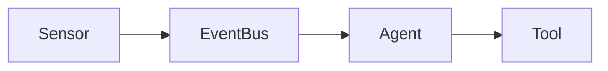

# Contributing

Contributions are open and welcome. VIRA is modular: you can work on one sensor,
agent, tool, API route or documentation page without understanding the whole
codebase.

!!! note "Canonical guide"
    The full contributor guide lives at
    [`CONTRIBUTING.md`](https://github.com/Vishalsng112/VIRA/blob/main/CONTRIBUTING.md)
    in the repository root. This page adds the documentation-specific rules and
    the local preview workflow.

## Get running locally

```bash
git clone https://github.com/Vishalsng112/VIRA.git
cd VIRA
python -m venv .venv
source .venv/bin/activate
pip install -r requirements.txt

# optional: local model
ollama pull nemotron-3.5-bolt:e4b

python run.py
```

The dashboard is at <http://localhost:8000>. On first run, admin credentials are
printed to the terminal.

## Documentation rules

Documentation is **Docs-as-Code**. Every page lives in `docs/` as Markdown and is
reviewed in the same pull request as the code it describes.

### Where does a page go?

The site follows [Diátaxis](https://diataxis.fr/). Pick exactly one purpose:

| Kind | Audience | Location |
|---|---|---|
| **Tutorial / how-to** | End users | `docs/user/` |
| **Explanation / architecture** | Developers | `docs/dev/` |
| **Reference** | Both | `docs/reference/` |
| **Design document** | Developers | `docs/dev/designs/` |
| **Roadmap** | Developers | `docs/dev/roadmap/` |

Do not add loose Markdown to the repository root. If a page does not fit, open an
issue before writing it.

### Write and preview

```bash
./scripts/docs.sh serve      # http://127.0.0.1:8001
./scripts/docs.sh build      # strict build, same as CI
```

The script creates a project-local `.venv` with the docs toolchain. Do not run the
system `mkdocs` binary directly: it may not have Material installed and will fail
with `No module named 'material'`.

The build is strict in CI, so broken internal links or missing nav entries fail
the pull request.

### Front matter

Every page starts with a single H1. The title is taken from it; no front matter is
required. Use sentence case for headings.

### Images and diagrams

- Put images in `docs/assets/` and reference them relatively (`assets/foo.svg`).
- Prefer SVG for architecture diagrams.
- Prefer Mermaid fenced blocks for new diagrams so they render in both HTML and
  PDF:

````markdown

````

### Linking

- Link other pages with relative `.md` paths: `[Plugin SDK](../dev/plugin-sdk.md)`.
- Link source files with full GitHub URLs, not relative paths.
- Do not link to a heading that does not exist; the build fails.

### Definition of done

A pull request that changes public behaviour, configuration or an extension point
is not done until:

- [ ] the matching page under `docs/` is updated, and
- [ ] `mkdocs build --strict` passes locally, and
- [ ] new pages are added to `nav` in `mkdocs.yml`.

### Publishing

The `docs` workflow builds the site and both PDFs on every push and pull request.
On `main` it deploys a versioned site with `mike`; on a `v*` tag it publishes that
version and attaches both PDFs to the GitHub release.

One-time repository setup: **Settings → Pages → Source: Deploy from a branch →
`gh-pages` / root**.

## Pull request checklist

See the repository
[pull request template](https://github.com/Vishalsng112/VIRA/blob/main/.github/pull_request_template.md).

## Getting help

Open a
[discussion or issue](https://github.com/Vishalsng112/VIRA/issues), or look for a
[`good first issue`](https://github.com/Vishalsng112/VIRA/issues?q=is%3Aissue+is%3Aopen+label%3A%22good+first+issue%22).
