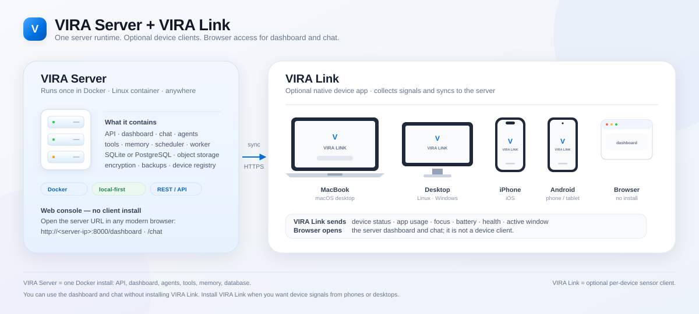

# VIRA Documentation

**VIRA** is a self-hosted, local-first context and tool server for AI agents. It
gives agents private access to your devices, memory, data and MCP tools, with
permissions and an audit trail in your hands. It also ships a control center, chat
workspace, memory, durable workflows and specialist agents.

## Two pieces

| Piece | What it is | Where it runs |
|---|---|---|
| **VIRA Server** | API, dashboard, chat, agents, tools, memory, database, scheduler, admin | Docker container (Linux, macOS, Windows) |
| **VIRA Link** | Device companion: collectors, offline ledgers, sync, command polling | Android, iOS (unsigned), web/PWA, Linux, Windows and macOS (Apple Silicon). Intel Macs use the web/PWA build. |

The browser dashboard and chat are served by VIRA Server and need no separate
install. VIRA Link is only needed on devices whose signals you want to collect.

## Start here

-   **I want to see it work**

    ---

    Run the reproducible five-minute demo: chat, live tool calls and a read-only
    database boundary.

    [:octicons-arrow-right-24: Five-minute proof](user/demo.md)

-   **I want to run VIRA**

    ---

    Install the server in minutes, then open the dashboard.

    [:octicons-arrow-right-24: Getting started](user/getting-started.md)

-   **I want to trust it**

    ---

    Authentication, consent, encryption, sandboxing and known limitations.

    [:octicons-arrow-right-24: Security overview](user/security.md)

-   **I want to build on VIRA**

    ---

    Architecture, plugin SDK, event schemas and design documents.

    [:octicons-arrow-right-24: Developer manual](dev/index.md)

-   **I want to know the plan**

    ---

    Maturity phases, acceptance criteria and deferred research.

    [:octicons-arrow-right-24: Product roadmap](roadmap.md)

## How these docs are built

The documentation is **Docs-as-Code**: every page is Markdown in this repository,
reviewed in the same pull request as the code it describes. CI builds the HTML
site you are reading and generates the PDF manuals from the exact same sources —
there is no separately maintained copy.

- **HTML** — rebuilt on every push to `main`
- **PDF** — `VIRA User Manual` and `VIRA Developer Manual`, rebuilt on every
  release and attached to GitHub Releases
- **API reference** — generated from the FastAPI OpenAPI schema, so it cannot
  drift from the code

See [Contributing](dev/contributing.md) for how to add or change a page.
