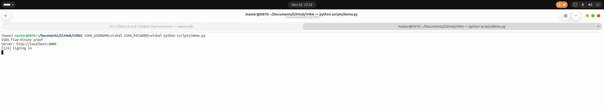

# Five-minute proof

This is the fastest way to see what VIRA actually does: authenticated chat, a real
agent tool loop, live tool activity and a read-only database boundary.



<video controls playsinline width="100%">
  <source src="../assets/demo.mp4" type="video/mp4">
  Your browser does not support embedded video.
  <a href="../assets/demo.mp4">Download the MP4</a>.
</video>

*Demo recording: 12 seconds. The transcript below is the longer written version.*

## Before you start

- VIRA Server is running (`http://localhost:8000` by default).
- The first admin account has been created in the browser.
- A model is available and the Chatbot agent is enabled.
- Python 3.11+ is available (the demo script uses only the standard library).

If you installed with the one-command installer, the repository is usually at
`~/vira`.

## Run it

```bash
cd ~/vira

export VIRA_USERNAME="your-admin-username"
export VIRA_PASSWORD="your-admin-password"

python3 scripts/demo.py
```

On a remote server:

```bash
python3 scripts/demo.py --url http://192.168.1.20:8000
```

Ask one custom question instead:

```bash
python3 scripts/demo.py --ask "Which agents are enabled?"
```

## What it proves

1. **Authentication works.** The script signs in with a normal VIRA session.
2. **The agent loop works.** The Chatbot chooses tools instead of guessing.
3. **Database tools work.** Device questions are answered from the live database,
   not from model memory.
4. **The boundary is real.** The final step shows write queries and secret-column
   reads being rejected before they reach the database.

Example output:

```text
VIRA five-minute proof
Server: http://localhost:8000
[1/4] Signing in
  ✓ signed in as vishal
[2/4] Creating a demo conversation
  ✓ conversation ready
[3/4] Asking the Chatbot

You: How many devices are connected with my account? Use the database tools.
  … Thinking
  → database_account_summary
    ✓ database_account_summary (10 ms)

VIRA: You have 4 devices connected to your account (vishal), and all 4 are
currently active.

You: How many devices are connected with the server? Use the database tools.
  → database_examples
    ✓ database_examples (6 ms)
  → database_query
    ✓ database_query (8 ms)

VIRA: There are 4 devices connected with the server, and all 4 are currently
active.

[4/4] Checking the read-only database boundary
  ✓ rejected: DELETE FROM devices — Only SELECT or WITH queries are allowed.
  ✓ rejected: UPDATE users SET role = 'admin' — Only SELECT or WITH queries are allowed.
  ✓ rejected: SELECT password_hash FROM users — Restricted identifier(s): password_hash
  ✓ allowed: SELECT COUNT(*) FROM devices
```

Answers depend on your own device count and data.

## If it fails

| Symptom | Next step |
|---|---|
| `Cannot reach ...` | Check `curl http://localhost:8000/livez`; start the server. |
| `HTTP 401` | Check the username/password, or create the admin in the browser first. |
| `HTTP 503` | The Chatbot agent is disabled or no model is available. |
| The model is slow | Local 9B models can take 20–60 seconds per answer. |
| Tool calls repeat or output is malformed | Run `python -m vira doctor`, then try a larger local model or a cloud provider. See [Choose a local model](models.md). |
| The chat UI shows a failure | Use **Retry**, **Switch model & retry** (administrator) or **Show what failed** in the recovery panel. |

Run the doctor first when a first session fails:

```bash
python -m vira doctor
```

It checks the model, its context size, Ollama, the port, the Chatbot, the
database and the master key, and prints a fix for each problem.

## Safety boundary

The read-only database tools are documented in
[Database tools](../dev/architecture/database-tools.md). Custom SQL is
administrator-only, opens a read-only connection, accepts one `SELECT`/`WITH`
statement, and blocks writes, secret columns and internal tables.

Run the dedicated tests any time:

```bash
python3 -m unittest vira.tests.test_database_query -v
```
