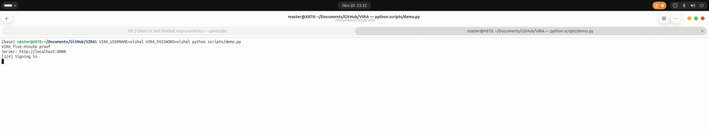

# Showcase

VIRA is designed to run on hardware you already own. This page collects the
reproducible demo and a few **deployment patterns** you can copy. Community
submissions will be added as they arrive; nothing here is a benchmark of model
quality.

## The five-minute proof

The canonical demo: sign in, ask about your own devices, watch the Chatbot call a
read-only database tool, and verify that writes are rejected.

- [Run the demo](../user/demo.md)
- [Tool-use benchmark](../dev/benchmarks/tool-use.md)
- [Agent platform evaluation](../dev/evaluations/agent-platform.md)

## Deployment patterns

These are patterns, not customer stories. Each one uses only features in the
current tree.

### 1. Family NAS assistant

- Docker Compose on a Linux NAS or mini-PC;
- bundled Ollama with the 9B default model;
- VIRA Link on family phones for consent-gated usage/focus signals;
- household users with separate accounts and per-device grants;
- nightly database backup and a separately stored master key.

**Why it works:** local-first data, one admin, a small web dashboard and no
cloud requirement.

### 2. Developer workstation companion

- source install or Docker Desktop;
- native Ollama for Metal on Apple Silicon;
- workspace-scoped filesystem/shell tools and the sandbox;
- MCP servers for local tools;
- approval gates for filesystem writes and sandbox execution.

**Why it works:** the agent can inspect a project and call tools while destructive
actions still require a human decision.

### 3. Study and focus coach

- VIRA Link on an Android phone with Usage Access;
- focus sessions and local insight ledgers;
- the `insight_coach` and `study_coach` specialists;
- daily/weekly summaries from aggregate data.

**Why it works:** the client aggregates locally and the server stores only the
signals the user enabled.

### 4. Private knowledge assistant

- RAG documents loaded from local notes;
- a local model or a configured cloud fallback;
- `rag_search` plus the read-only database tools;
- per-user document scope and redacted audit exports.

**Why it works:** retrieval and history stay on your server; answers can cite the
local documents they actually used.

## Add your deployment

We only publish deployments the owner has allowed us to describe publicly. Open a
**Showcase submission** issue with:

- the deployment pattern and hardware;
- which model tier you use;
- MCP servers/plugins and devices involved;
- one concrete outcome or lesson;
- a public link or screenshot if available.

Do not include private hostnames, IPs, tokens, device data or personal details.
Submissions are reviewed before publication.

## What we will not publish

- claims that VIRA is “verified” for generated tools/agents;
- screenshots with real credentials or personal data;
- benchmarks without a reproducible command and model/version;
- deployments the submitter cannot publicly describe.
